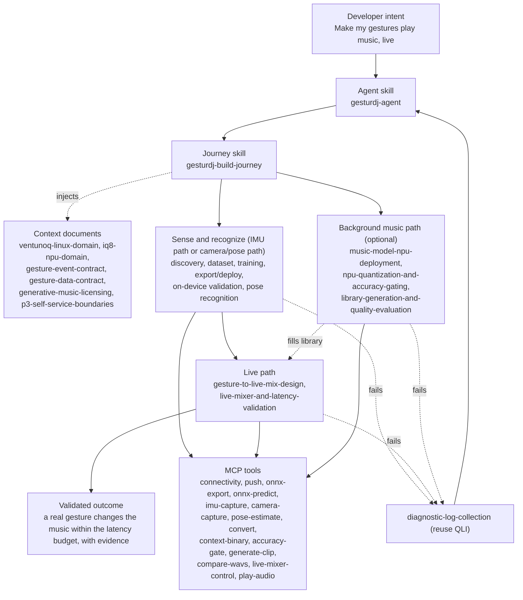

# GesturDJ: Applying the Synapse Skill Hierarchy

Back to the [GesturDJ README](README.md).

**Status:** proposed. 15 skills/context documents and 13 tools are written in [`skills/`](skills/) (sections 9 and 10); steps 1 to 5 of the build journey were run on a PC, and steps 4 and 5 were repeated on a Qualcomm IQ8 board (section 10). Everything in sections 3 to 8 is *proposed*, not evidenced.
**Where things are:** [`gesture_scripts/`](gesture_scripts/) holds the recognizer code, [`evidence/`](evidence/) the logs this document cites, and the DiffRhythm demo ([`diffrhythm_iq8_npu_int8_45s.ipynb`](diffrhythm_iq8_npu_int8_45s.ipynb), [`diffrhythm_npu_scripts/`](diffrhythm_npu_scripts/)) is the music side.
**Decisions applied:** gestures *create* music; it must **feel live**; gestures come from **IMU or camera/pose**; the **current layer model** is used; **P3 = Independent Developers**.
**Purpose:** dogfood the Synapse layer model on a second, non-QLI application. List the skills a P3 developer needs to finish GesturDJ, put each in a layer, and record where the model does not fit.

## Summary

**The exercise.** Apply the Synapse skill model (agent, journey, domain skill, MCP tool, context document) to GesturDJ, a second, non-QLI application, for a P3 developer (independent maker, hobbyist or student). List the skills each layer needs, document what does not fit, and say whether the model works.

**The application.** Gestures from an IMU (attached to an Arduino Ventuno Q) or a camera change music live. A live mixer plays a clip library; DiffRhythm fills the library in the background on the IQ8 NPU (a 45 s song takes about 4 to 6 minutes, so generation can never be on the live path).

**What the model produced.**

| Layer | Count | Examples |
| --- | --- | --- |
| Agent | 1 | `gesturdj-agent` |
| Journey | 1 | `gesturdj-build-journey` |
| Domain skills | 13 | device discovery, dataset, training, export, on-device validation, gesture-to-mix design, NPU deployment, quantization gating |
| MCP tools | 15 | export-onnx, onnx-predict, accuracy-gate, generate-clip, play-audio |
| Context documents | 6 | `gesture-event-contract`, `p3-self-service-boundaries` |

Written and validated so far: 15 skills and context documents and 13 tools ([`skills/`](skills/), `python skills/validate_skills.py` passes). Steps 1 to 5 of the build journey were run by hand on one PC: recognizer trained, exported to ONNX, parity 1.2e-06, latency p50 0.17 ms against a 50 ms budget. That run found 7 defects in the repo (for example, the documented torch-free path secretly imported torch) that reading alone would not have found.

**Verdict.** The layers and the publishing contract carried a second application with modest friction. The determinism test (tool or skill?) classified every operation without argument. The strain was never about layers; it was about who maintains and verifies a skill:
1. No home for novice prerequisite knowledge now that the foundational tier is gone (F0).
2. Persona awareness is missing: hardware a P3 can buy, public-only dependencies, community instead of named owners, safe defaults for self-service (F17, F18, F20, F21).
3. A latency budget and interaction mode should be a first-class early decision (F13).
4. Evidence: the validator checks that evidence exists, not that it supports the claim; "no evidence yet" passes (F23, F33).
5. The QLI validator is not portable to another catalog (F22).

**What is not shown.** Nothing has run on a Ventuno Q, with real sensor data, by a hosting agent, or on an unfiltered consumer PC (the test PC was behind a corporate proxy). The live mixer, audio output, music-side skills and the pose path are unwritten. So the P3 claim is partly tested: a P3 developer can now go from nothing to a validated recognizer on a PC, but not yet to a working DJ.

**Open decisions for the reviewers.** (1) Keep the hybrid live design? (2) Is the PC the accepted generator fallback when a P3 has no IQ8? (3) Is pose in scope for version one? (4) Which of the tools used are publicly downloadable? (5) Who maintains a community skill, and where is the feedback channel? (6) Can one Ventuno Q do both jobs (see open question 6)?

## 1. What GesturDJ is, and assumptions

**Definition (from the project lead):** the system understands the user's gestures and converts them into music.

**Answers applied (v3):** (a) the experience must *feel live*; (b) gestures may come from an **IMU** (attached to a Ventuno Q) **or a camera with pose estimation**; (c) use the current layer model; (d) **P3 = Independent Developers**: makers, hobbyists, students and community builders who work independently, learn and experiment, build personal or community projects, and use public self-service access through the Developer Portal with community support.

**Design consequence of "live"** (finding F13). DiffRhythm needs about 4 to 6 min for a 45 s song (10 to 13 min for 95 s) on the IQ8, so it cannot respond to a gesture in real time. A live-feeling GesturDJ therefore has to be a **hybrid**:

```
 LIVE PATH (milliseconds)                          BACKGROUND PATH (minutes, optional)
 IMU or camera -> gesture event -> mix action ->   sustained/novel gesture -> music intent ->
 live mixer over a library of clips -> audio out   DiffRhythm on the NPU -> new clip -> library
```

The generative model *fills the library*; gestures *play it live*. This is a recommendation, not a decision made by the repo: it needs your confirmation (open question 1).

| # | Assumption | Basis | If wrong |
| --- | --- | --- | --- |
| A1 | Gestures from **either** an IMU (an attached motion sensor, for example a Modulino node, since the Ventuno Q product page lists no onboard IMU; existing recognizer) **or** camera/pose. Both produce one shared **gesture event** (label, confidence, intensity, timestamp). | IMU assets in [`gesture_scripts/`](gesture_scripts/); camera/pose path is *proposed*: no pose asset exists in the repo (vision NPU work exists for AURA on IQ9, but nothing for pose). | A single sensing path removes one skill group in 4.3. |
| A2 | Music clips are generated offline (and optionally in the background) by **DiffRhythm**; DiT on the IQ8 NPU, text/style encoders and VAE on a PC. | Notebook [`diffrhythm_iq8_npu_int8_45s.ipynb`](diffrhythm_iq8_npu_int8_45s.ipynb). | Another generator changes only skills 8 to 10. |
| A3 | **P3 developer** = Independent Developer (makers, hobbyists, students, community builders; self-service via the Developer Portal; community support). | Project lead. | Replaces the earlier guess. Consequences in section 6. |
| A4 | Layer model = **current QLI model**: Agent, Journey, Domain skill, MCP Tool, Context Document. | `qli_dogfooding/skills/README.md`, `CONTEXT.md`, ADR 0001. | See section 2. |

## 2. Layer model mismatch (finding F0)

The request names **Agentic, Journey, Domain, Foundational**. The current reference removed the foundational tier (ADR 0001; `CONTEXT.md` lists "foundational skill" under *Avoid*): its content became MCP tools (deterministic) and domain skills (conditional judgment), with platform rules in a context document. The project lead confirmed the layer model; read as the current model. A side-by-side with the four-layer version is not done; section 6 (F0) shows where "foundational" knowledge for a novice ends up, which is the practical difference.

Classification test (ADR 0001): *if the correct action is known and an agent adds no value, it is an MCP tool. If sequencing or safety judgment depends on discovered state, it is a domain skill.*

## 3. Proposed hierarchy



## 4. Skills by layer

"Wraps" = existing asset. "Stage" = developer journey stage (Discovery, Enablement, Platform Experience). "Reuse" = what the QLI catalog already provides.

### 4.1 Agent layer (1)

| Skill | Responsibilities | Not responsible for | Approval gates | Stage |
| --- | --- | --- | --- | --- |
| `gesturdj-agent` | Interpret open intent ("make my board DJ", "add a gesture", "why is the song dull", "why does it take 10 minutes"); choose the smallest safe path; show the plan; checkpoint after each skill; route failures to diagnostics, then back for a recovery decision; **keep the live path within its latency budget and keep the background path optional** (F13). | Training hyperparameters, musical taste, board hardware repair. | Writing to a board (`scp`, `apt`, flashing); capturing the developer's sensor data; overwriting a model or context binary; any model/dataset download; opening a camera (privacy); **board reboot** (a hung NPU process needs one); storing a credential (never; env var only). | all |

### 4.2 Journey layer (1, optionally 2)

| Skill | Outcome | Composes | Stage |
| --- | --- | --- | --- |
| `gesturdj-build-journey` | A working GesturDJ: recognizer deployed (IMU or pose), clip library available, a gesture changing the music live within budget, with evidence. Background generation is an optional branch. | All domain skills below, plus MCP tools. | Discovery to Enablement |
| `gesturdj-perform-journey` (optional) | The runtime session: capture gesture, recognize, mix, play; optionally queue a background generation. Tests whether "build" and "run" are separate journeys (QLI has one). | Skills 5, 6, 7, 12 in 4.3. | Platform Experience |

### 4.3 Domain skills (conditional judgment) (13)

| # | Skill | Judgment it needs | Wraps | Reuse from QLI | Stage |
| --- | --- | --- | --- | --- | --- |
| 1 | `device-and-host-discovery` | Which devices exist (Ventuno Q, IQ8, PC/WSL)? OS, arch, Python, whether `torch` is safe, QAIRT version, NPU generation (v75 vs v73), free disk/memory. The "golden skill"; here it must cover **several devices**. | [`gesture_scripts/ventunoq.md`](gesture_scripts/ventunoq.md), [`diffrhythm_iq8_npu_int8_45s.ipynb`](diffrhythm_iq8_npu_int8_45s.ipynb) preflight | `device-identity-discovery`, `host-environment-validation` (pattern) | Discovery |
| 2 | `gesture-dataset-preparation` | Synthetic vs uWave vs own capture; class balance, sample rate/length; can the data support the wanted gestures? | [`make_synthetic_dataset.py`](gesture_scripts/make_synthetic_dataset.py), [`download_dataset_uwave.py`](gesture_scripts/download_dataset_uwave.py), [`gesture_io.py`](gesture_scripts/gesture_io.py) | none | Enablement |
| 3 | `gesture-model-training-and-evaluation` | sklearn vs PyTorch; read accuracy/confusion; over-fitting; more data vs features/window. | `train_gesture*.py`, [`gesture_features.py`](gesture_scripts/gesture_features.py) | none | Enablement |
| 4 | `model-export-and-deployment` (gesture model) | ONNX opset/dtype vs the device runtime; PC-vs-device parity. | [`export_gesture_pytorch_to_onnx.py`](gesture_scripts/export_gesture_pytorch_to_onnx.py), [`predict_gesture_onnx.py`](gesture_scripts/predict_gesture_onnx.py) | `ai-model-execution` (pattern) | Enablement |
| 5 | `on-device-gesture-validation` | Same accuracy on device as on PC? Latency within budget? Tune window/stride. | [`smoke_test.py`](gesture_scripts/smoke_test.py), [`predict_gesture_onnx.py`](gesture_scripts/predict_gesture_onnx.py) | `baseline-evidence-collection` (pattern) | Enablement |
| 6 | `gesture-to-live-mix-design` | Map a gesture event (label, intensity, speed) to a **live mix action** (switch clip, tempo, volume, filter, layer on/off) with debounce and cooldown; and, for the background path, to a music intent (style prompt, mood, valid LRC: one `[mm:ss.xx]` line per timestamp, no empty lines). | new; prompt/LRC format from the notebooks | none | Platform Experience |
| 7 | `music-model-npu-deployment` | Export the DiT in segments, convert, push (chunked, md5-checked), build context binaries; choose QAIRT version (2.47.1 baseline; 2.49 per-layer embedding bug, 2.51 HTP init failure); recover from board resets. | [`diffrhythm_iq8_npu_int8_45s.ipynb`](diffrhythm_iq8_npu_int8_45s.ipynb), [`build_dit_server.sh`](diffrhythm_npu_scripts/build_dit_server.sh), [`export_segments.py`](diffrhythm_npu_scripts/export_segments.py) | `ai-model-execution` (pattern) | Enablement |
| 8 | `npu-quantization-and-accuracy-gating` | W8A16 vs W8A8; which segments tolerate int8 (middle two: yes; first/last: no); gate cosine vs fp32; per-segment probe; per-pass check on real inputs; **listen** (the one-case gate overstated quality: 0.99998 vs 0.953 mean on real inputs). | [`diffrhythm_iq8_npu_int8_45s.ipynb`](diffrhythm_iq8_npu_int8_45s.ipynb), [`gate_board.py`](diffrhythm_npu_scripts/gate_board.py), [`make_calib.py`](diffrhythm_npu_scripts/make_calib.py) | none | Enablement |
| 9 | `library-generation-and-quality-evaluation` | Build the clip library offline: which prompts/styles, steps vs time (45 s song: 16 steps about 4 to 6 min), same-seed A/B, loopable length and tempo, objective metrics (`snr`, `lsd`, `hf_ratio`) tell which to listen to, not which is better. | [`infer_iq8.py`](diffrhythm_npu_scripts/infer_iq8.py) | none | Platform Experience |
| 10 | `audio-output-integration` | Which player/device exists (`paplay`, `pw-play`, `aplay`, ...); what to do when the board has no audio sink; buffer size vs latency. | audio cells in the int8 notebook | none | Enablement |
| 11 | `live-mixer-and-latency-validation` | Gesture-to-sound latency budget (sensor, inference, mix, audio buffer); end-to-end timing with a real gesture; jitter; false-trigger rate. | new | `ai-inference-benchmark` (pattern; QNN-specific) | Platform Experience |
| 12 | `pose-gesture-recognition` (camera path, *proposed*) | Choose a pose model, camera framing and frame rate; turn keypoints into the same gesture event as the IMU path; privacy handling; compare accuracy/latency of CPU vs NPU. | none in repo | vision NPU work (AURA, IQ9) is the nearest asset | Enablement |
| 13 | `diagnostic-log-collection` | What to collect for which failure (`dmesg` external aborts, `server.err`, `genq_*.log`). | existing logs | **Reuse** (check portability) | Platform Experience |

### 4.4 MCP tools (deterministic, no skill wrapper) (15)

| Tool | Single operation | Wraps | Inventory check |
| --- | --- | --- | --- |
| `device-connectivity-validation` | ping/SSH a board with a pinned host key, report reachable | QLI tool | reuse if portable |
| `push-artifacts` | chunked, checksum-verified copy to a board | notebook `push` helper | QLI `ssh` exposure candidate |
| `make-synthetic-dataset` | generate a dataset from a seed | [`make_synthetic_dataset.py`](gesture_scripts/make_synthetic_dataset.py) | new |
| `export-onnx` | gesture checkpoint to ONNX | [`export_gesture_pytorch_to_onnx.py`](gesture_scripts/export_gesture_pytorch_to_onnx.py) | new |
| `onnx-predict` | classify one sample file | [`predict_gesture_onnx.py`](gesture_scripts/predict_gesture_onnx.py) | new |
| `imu-capture` | record N seconds of data from an attached motion sensor to CSV (the board lists no onboard IMU) | not in repo (F5) | path undecided |
| `qairt-convert` | ONNX to DLC | `qairt-converter` | likely exists in Qualcomm tooling |
| `build-context-binary` | DLC to HTP context binary on the board | `gen_q.sh` / `qnn-context-binary-generator` | likely exists |
| `accuracy-gate` | cosine of a model vs a saved reference | [`gate_board.py`](diffrhythm_npu_scripts/gate_board.py) | new |
| `generate-clip` | one DiffRhythm run with fixed seed/steps/prompt/LRC | [`infer_iq8.py`](diffrhythm_npu_scripts/infer_iq8.py) | new |
| `camera-capture` | grab N frames from a camera to files | not in repo | new (F5) |
| `pose-estimate` | keypoints for one image/frame | not in repo | check Qualcomm AI Hub / shared inventory first |
| `live-mixer-control` | send one mix command (clip, tempo, volume, filter) to the mixer | not in repo | new |
| `compare-wavs` | snr/corr/lsd/hf metrics between two songs | not in repo | new |
| `play-audio` | play a file on the default sink, time-limited | notebook cell | new |

### 4.5 Context documents (injected, never selected) (6)

| Document | Holds |
| --- | --- |
| `ventunoq-linux-domain` | Ubuntu on Ventuno Q (Debian is announced), avoid `torch` on the board (an import crash, SIGILL, was seen on the UNO Q and is unchecked on the Ventuno Q), ONNX Runtime only, storage/memory, SSH, safety gates, owner. |
| `iq8-npu-domain` | QLI 2.0 on IQ8 (HTP v75): QAIRT-less image so host runtime plus DLC is pushed; QAIRT version cautions; the known board memory fault (resets while loading about 2.3 GB of context binaries); a hung NPU process needs a reboot; bundles must live on a plain disk; credentials only via environment variables. (Corporate TLS/Netskope handling is a Qualcomm-internal concern and does **not** belong in the P3 version; see F18.) |
| `gesture-event-contract` | The one shared interface between sensing and everything after it: fields (label, confidence, intensity, timestamp, source = imu/pose), rate, latency budget. Lets IMU and camera paths be swapped. |
| `p3-self-service-boundaries` | What an independent developer can assume: only public downloads and the Developer Portal, no internal builds or accounts, community support only, hardware they can actually buy, no corporate network quirks, safe defaults (no `sudo`/flashing without a gate). |
| `gesture-data-contract` | `DATASET_ROOT/<label>/*.csv`; columns `ax, ay, az` (or `x, y, z`, or first three numeric); `.npy` as `(T,3)`; sample-rate/window assumptions. |
| `generative-music-licensing` | DiffRhythm code Apache-2.0; MuQ-MuLan weights CC-BY-NC-4.0 (evaluation only); dataset licenses; what may be shown or shipped. |

### 4.6 Count versus QLI

QLI: 1 agent, 1 journey, 5 domain, 3 MCP, 1 context. GesturDJ: 1 agent, 1 to 2 journey, 13 domain, 15 MCP, 6 context. The domain count is high (F11).

## 5. Real evidence behind several skills

Skills 7 to 9 are not hypothetical: the DiffRhythm work already produced the facts they would encode (mixed-precision int8: seg1/seg2 int8, seg0/seg3 fp16, gate cosine 0.99998, 6.2 s vs 9.0 s per pass, but 0.953 mean cosine on real inputs; percentile calibration made it worse, cosine -0.04; PermissionError when re-extracting results fixed by reading the tar in memory). That is the "known_failure_modes" and "two_config_evidence" content the publishing contract asks for. Skills 2 to 6 have code but no field evidence on the Ventuno Q yet.

## 6. Fuzzy areas (do not fit one layer cleanly)

| ID | Item | Why it is fuzzy | Placed in | Suggested model change |
| --- | --- | --- | --- | --- |
| F0 | Foundational knowledge for a novice | Windowing time series, train/validation split, what quantization is, NPU graph segmenting, Linux audio, SSH/venvs. Not a tool, not judgment about discovered state. The tier was removed, so there is no home. | Documentation links from context documents | A named **knowledge/learning layer**, or an explicit statement that prerequisites live in docs. |
| F1 | Data schema | A rule document that is also checked against real files. | Context document + check inside skill 2 | A context document may name a validator tool it expects. |
| F2 | Training and generation | One command, but long-running (minutes to hours), non-idempotent, needs interpretation. | Domain skills 3, 9 | Rule for long-running, resumable operations (detached run, poll, retry after board reset). |
| F3 | Artifacts (datasets, `.pt`, `.onnx`, DLCs, context binaries, songs) | They carry state across skills and devices, have versions and licenses, go stale (a QAIRT change invalidates context binaries). No layer owns them. | `state_before/after` fields | **Governed artifacts**: owner, version, provenance, compatibility. |
| F4 | Multi-device flow (Ventuno Q senses, PC encodes/decodes, IQ8 generates) | QLI skills assume one target device; discovery is per device but journey state spans several. | Journey holds per-device profiles | Multi-device profile in the golden discovery skill. |
| F5 | Sensor acquisition (MCU sketch, bridge/RPC, IMU sampling rate) | Firmware plus hardware, outside the Linux context; the board lists no onboard IMU, so a sensor such as a Modulino node is needed; owner unclear (Arduino stakeholder question open in ADR 0001). | Undefined `imu-capture` tool | Hardware/firmware boundary statement per context document. |
| F6 | Intent design (gesture to prompt/LRC) | Creative, the developer's own code; quality is judged by ear, not by a status. | Skill 6 as guidance + template | Separate **guidance skills** (no bounded verifiable operation) from operation skills. |
| F7 | Performance and quality evidence | Latency distributions, cosine, audio metrics; QLI evidence is readiness status. | Skills 5, 8, 9 | Add **performance** and **quality** evidence types. |
| F8 | "It works" | A person gestures and music results; subjective and physical. | Last journey gate | **Human-in-the-loop** validation gate type. |
| F9 | Ownership of non-Qualcomm software on Qualcomm hardware | PyTorch, ONNX Runtime, PipeWire, DiffRhythm are third-party; "product teams own device skills" does not say who owns these. | Provisional owner | Ownership and exit criteria for 3P-stack-on-Qualcomm skills. |
| F10 | Licensing of models, data, music | Not a technical skill; a gate with commercial consequences (CC-BY-NC weights). | Context document + agent gate | **Licensing/provenance gate** among the review gates. |
| F11 | Proliferation | 11 domain skills for one app (e.g. 7+8, 4+5, 2+3 may always run together). | Kept separate for now | Test merging once real use shows co-occurrence. |
| F12 | Reuse across products | QLI skills are QLI-named; reuse of connectivity/diagnostics may not be portable. | "Check portability" | Define generic vs product-specific variants. |
| **F13** | **Live feel vs generation time** | Gestures are real-time; one 45 s song takes about 4 to 6 min on the IQ8. Resolved (proposed) as a hybrid: gestures drive a live mixer over a clip library; the music model fills the library offline or in the background. The latency budget and the split are an architectural decision no layer currently owns. | Agent gate; skills 6, 9, 11 | **Interaction-mode selection** and a **latency budget** as a first-class early decision. |
| F14 | Reliability as a known failure mode vs a defect | The board resets under load (memory fault, escalation pending). Skills can retry, but it is not a skill concern. | `known_failure_modes` + context document | Distinguish platform defects from skill bugs in the review gates. |
| F15 | Secrets and connections | Passwords were once typed into chat; the rules say env vars only, never in notes. | Control block + agent gate | Standard secret-handling rule in the publishing contract. |
| F16 | PC-hosted "device" pipeline | The IQ8 only runs the DiT; text/style encoders and VAE run on a PC. "Runs on device" is partly false. | Context document `iq8-npu-domain` | Require each skill to state **where each stage runs**. |
| **F17** | **P3 hardware reality** | Independent developers can buy an Arduino Ventuno Q; an IQ8 EVK is not obviously a hobbyist board (price, availability unknown to me). The best-evidenced skills (7, 8, 9) assume it. | Skills 7 to 9 marked "needs hardware the persona may not have" | Skills must declare **required hardware and its accessibility per persona**; offer a fallback (PC CPU, X Elite laptop, or an already-generated library) so a P3 can still finish. |
| **F18** | **Internal vs public tooling** | Much of what the DiffRhythm work used is internal or semi-internal (QAIRT builds, specific versions, Netskope certs, a private network, internal SharePoint). P3 only has the public Developer Portal. | `p3-self-service-boundaries` context document | Every skill needs a **visibility** check (the contract has `visibility`: internal / entitled / public); verify each dependency is publicly downloadable before publishing to P3. |
| **F19** | **Two sensing paths, one skill chain** | IMU and camera/pose differ in data, hardware and privacy, but converge on one gesture event. Layers say nothing about alternatives or fusion. | `gesture-event-contract` + parallel domain skills | Allow **alternative implementations behind one contract** (a skill interface), and decide whether fusion is a skill. |
| **F20** | **Community support instead of owners** | The contract assumes a named owner, backup, review cadence. P3 gets community support; who maintains a skill for hobbyists? | Contract fields, provisional owner | Define a **community-maintained** maturity level and what the feedback channel is (Developer Portal forum). |
| **F21** | **Safety for self-service** | A novice with no support runs `scp`, installs packages, opens a camera, may reboot a board. Approval gates carry more weight than in a supported setting. | Agent gates; `p3-self-service-boundaries` | Gate defaults should depend on the **persona**, not only on the action. |

## 7. Dogfooding verdict

**Held up:** the determinism test classified every operation without argument; the context-document layer fit the platform rules (SIGILL, QAIRT versions, memory fault, licensing, the new P3 boundaries); one agent plus one journey mapped cleanly; skills 7 to 9 have real evidence to fill the publishing contract. The "live" requirement and the two sensing paths were absorbed by adding skills and a context-document contract (`gesture-event-contract`), not by changing the model, which is a good sign.

**Needs improvement (priority order):** (1) latency budget and interaction mode as first-class (F13); (2) persona awareness: hardware accessibility, public-only dependencies, self-service safety, community ownership (F17, F18, F20, F21); (3) alternative implementations behind one contract (F19); (4) a place for novice prerequisite knowledge (F0); (5) multi-device journeys and "where each stage runs" (F4, F16); (6) performance, quality and human-in-the-loop evidence (F7, F8); (7) governed artifacts, ownership of third-party stacks, licensing, secrets (F3, F9, F10, F15).

**Biggest risk to the claim "this works":** the best-evidenced skills (NPU deployment, quantization) rely on hardware and internal tooling a P3 developer may not have. As written, a P3 could finish the *recognition* half but probably not the *generation* half. That is the first thing to resolve.

**Not tested:** the music side (live mixer, audio output, NPU deployment skills), the Ventuno Q, real sensor data and a hosting agent. Section 9 scaffolds the first five skills and section 10 runs the build journey on a PC.

## 8. Open questions

Resolved by the project lead: interaction mode (live), sensing (IMU or camera/pose), layer model (current), P3 definition (Independent Developers).

1. **Hybrid design OK?** Gestures drive a live mixer over a clip library; DiffRhythm fills the library offline or in the background (F13). Confirm or choose another split.
2. **Can a P3 developer get the music hardware?** If an IQ8 is not accessible to them, what is the P3 path for generating the library (PC CPU about 36 min per song, X Elite NPU about 29 min, or ship a pre-generated library)? (F17)
3. **Camera/pose:** which pose model and which board (the Ventuno Q lists a 40 TOPS NPU and three camera inputs, so it is a candidate)? Is a pose path in scope for the first version or a later one?
4. **Public availability:** which of the QAIRT/Genie versions and tools used here can an independent developer download? (F18)
5. **Maintenance:** who maintains a community-supported skill, and where does feedback go (F20, F24)?
6. **One board for both jobs?** The Ventuno Q uses the same Dragonwing IQ8 family as the IQ8 board that runs DiffRhythm here (40 TOPS NPU, 16 GB RAM, per its product page). If the NPU song run works on it, a P3 developer needs one board instead of two, which would ease the hardware-access risk (F17). Not tested: it needs the Ventuno Q's own memory behaviour and NPU runtime checked.

## 9. Scaffold result: what applying the QLI contract to a non-QLI skill showed

Written in [`skills/`](skills/): `gesturdj-agent`, `device-and-host-discovery`, `gesture-to-live-mix-design`, and the context documents `gesture-event-contract` and `p3-self-service-boundaries`, plus [`README.md`](README.md) (catalog; `pose-gesture-recognition` is a pointer only) and [`validate_skills.py`](skills/validate_skills.py). All five manifests parse as YAML and `python skills/validate_skills.py` passes. Decisions applied from the project lead: hybrid live design confirmed; the PC is the generator fallback when an IQ8 is not accessible; pose is a pointer, not an implementation; tools used in the repo are treated as public; skills live in a `skills` folder.

**Findings from doing it** (the dogfooding result):

| ID | Finding | Evidence | Suggested change |
| --- | --- | --- | --- |
| F22 | The QLI validator is not portable. `inspect_toolkit.py` hardcodes the 11 QLI skill ids and the QLI project layout (it also checks 51 workflows), so it cannot validate another catalog. | Had to write [`validate_skills.py`](skills/validate_skills.py) with the field lists copied from it. | Split the generic *manifest/contract check* from the QLI-specific *toolkit check*; ship the generic part as shared Synapse tooling. |
| F23 | The contract demands `two_config_evidence`, but a proposed skill has none. The validator only checks that the key is present, so the placeholder "none yet" passes, same as real evidence. | All five manifests pass while having no run evidence. | Validate that evidence entries reference a dated run; make "no evidence" visible in the status (the `review_gates` text says it, the validator does not). |
| F24 | Several required fields have no real value for P3: `backup_owner`, `feedback_channel` (no community channel exists), `review_cadence`. | Filled with "TBD" and a GitHub-issues stopgap. | Define a community-maintained variant of the contract (F20 confirmed in practice). |
| F25 | `visibility: public` is declared, but the review gate "discoverability" is open (no Developer Portal listing). Visibility is a claim with no check. | `review_gates.discoverability: open` | Tie `visibility: public` to a verified listing. |
| F26 | A context document needs a `skill.yaml` with the whole publishing contract, though it is never executed (approved_tools and endpoints are empty). | `gesture-event-contract`, `p3-self-service-boundaries` | A slimmer contract for context documents. |
| F27 | "Treat the repo's tools as public" was applied by decision, not verified. QAIRT/Genie versions used in the DiffRhythm work are not confirmed downloadable by an independent developer. | Open question 4, answered as an assumption. | A per-dependency public-availability check before `visibility: public` (links to F18). |

**Verdict so far:** the layer model and the contract carried a second, non-QLI application with modest friction. The strain points are all about *who maintains and verifies*, not about layers: evidence (F23), community ownership (F24), visibility (F25) and shared tooling (F22). The skills themselves are unvalidated until run on a Ventuno Q and a PC-only setup.

## 10. First real test: the build journey run on a PC

**What was run:** steps 1 to 5 of `gesturdj-build-journey` by hand, as an independent developer would, on one Windows PC (an ARM64 machine running x64 Python 3.10 under emulation), in a **clean virtual environment installed from the repo's own requirements files**. Logs, JSON reports and the failed runs are in [`evidence/pc-run/`](evidence/pc-run/). Synthetic data only; no Ventuno Q; no real sensor; not run by an agent.

**Result when the fixes were in:** discover OK; dataset 150 samples, 3 labels, `ok: true`; sklearn held-out accuracy 0.70, PyTorch 1.00 (30 held-out samples); ONNX export OK (single 163 KB file); parity 1.19e-06; held-out accuracy 1.0; latency p50 0.17 ms, p95 0.75 ms against a 50 ms budget; the shipped predictor runs with only numpy and onnxruntime.

**Repeat on a Qualcomm IQ8 board:** the board skill `device-and-host-discovery` and steps 4 and 5 were run on an IQ8 (aarch64, Qualcomm Linux 2.0, Python 3.14.4, no torch), with the same exported model and the same synthetic data. Result: ONNX Runtime 1.31.1 loads, held-out accuracy 1.0 on 30 samples, latency p50 0.228 ms and p95 0.282 ms against the 50 ms budget, parity skipped as designed. Evidence: [`evidence/iq8-run/`](evidence/iq8-run/). Findings from this run:

- The board image has **no `pip`, no `venv` and no package repository** (`dnf` lists none), because its Python is a split Yocto build without `venv`, `ensurepip`, `colorsys`, `xml`, `xmlrpc` and `pyexpat`. Two routes worked. (a) Download the aarch64 wheels on a PC (`pip download --platform manylinux_2_28_aarch64 --python-version 3.14 --only-binary=:all:`), copy them over and put them on `PYTHONPATH`. (b) Copy the pure-Python modules the image lacks from the CPython 3.14.4 source `Lib/` into a folder on `PYTHONPATH`, add a small `pyexpat` stub (pip only imports it, never parses XML), then `python3 -m venv venv` and `pip install onnxruntime numpy` work, and the skills pass again from the venv ([`onnx-validation-venv.json`](evidence/iq8-run/onnx-validation-venv.json)). `model-export-and-deployment` should say so. Running the unverified `get-pip.py` straight on the board was not done.
- `discover_host.py` probes only the machine it runs on. The camera, audio sink and board fields of `device-profile.json` stay `unknown` unless the SSH probe is run by hand; the board probe is saved as [`board-probe.txt`](evidence/iq8-run/board-probe.txt).
- A live mixer ([`live_mixer.py`](gesture_scripts/live_mixer.py)) replays sensor windows through the recognizer and the mix map. On the IQ8: 4 of 6 events applied (1 debounced, 1 cooldown), worst estimated gesture-to-sound 45.7 ms against 200 ms. The default `aplay` buffer is 500 ms, which alone would blow the budget, so the mixer sets a 40 ms buffer; the figure is an estimate and was not measured at the speaker.
- Cross-machine parity: PC and IQ8 logits for 150 samples differ by at most 2.4e-07 and agree on the top label 150 of 150 ([`cross-machine-parity.json`](evidence/iq8-run/cross-machine-parity.json)). This replaces the skipped torch parity on the board.
- A coding assistant ran the journey as the hosting agent once; the checkpoint log, including a blocked action and its recovery, is in [`agent-run-log.md`](evidence/iq8-run/agent-run-log.md).
- The five remaining domain skills were then written and run on the IQ8: audio output, live latency, NPU deployment, accuracy gating and library generation. Results, all in [`evidence/iq8-run/`](evidence/iq8-run/):
  - **The audio stage decides the budget, and spawning a player per gesture fails it.** Timing the player process gave 112 to 237 ms, which looked fine, but it is not when sound starts: the player exits before the hardware plays. Polling the ALSA PCM until it is `RUNNING` and adding the queued frames gives a cold first-sound time of 236 ms (`pw-play`), 237 ms (`aplay`) and 280 ms (`paplay`), each over the 200 ms budget on its own. With that stage the live path's p95 is 260.6 ms and fails; with a 500 ms buffer it is 511 ms. The 45.7 ms and 145 ms figures above and in earlier versions understate it. A warm stream's floor is the hardware queue, 52.7 ms. Design consequence, then built and measured: keep one output stream open and switch what is written into it (`warm_output.py`, `live_mixer.py --player warm`). Into a null sink the warm stream takes 37 to 38 ms (p50) and 44 to 48 ms (p95, max 59 ms) against 116 to 132 ms (p95 145 to 152 ms) for a player started per gesture; with the 52.7 ms hardware queue the live path's p95 is 112.6 ms and passes. A first version hid a constant 164 ms backlog because audio written before the stream connected queued in the pipe; capping the pipe at 4096 bytes fixed it. Still estimates: a null sink is a proxy for the real sink, and nothing was measured at a speaker.
  - **Speaker level is not measurable on this board.** The sound server lists a speaker and a microphone, but a 1 kHz tone was not heard by the microphone, so neither is attached. A real check needs a speaker, a microphone or a line-out recorder, and a known-time click.
  - **Music model on the NPU.** The preflight is clean (NPU firmware running, 0 external aborts, 8 of 8 context binaries). The accuracy gate: fp16 cosine 0.99999, mixed int8 0.99986, both as good as fp16. All-int8 graphs fail it (cosine 0.763 at 44.6 s, 0.61 at 95 s earlier), which is why the first and last graphs stay fp16.
  - **Clip library.** Three 44.6 s clips (folk, electronic, ambient) pass the objective checks, loudness spread 3.3 dB. Loop seams of 4 to 17 dB mean they should be played once or crossfaded, not looped. NPU time was steady at about 80 s per clip; wall clock was 5.7 to 12.2 min because the PC-side steps vary.
  - **The board's Python is missing standard-library modules** (for example `statistics`), so the scripts avoid them.
- This is an IQ8, not a Ventuno Q, and still synthetic data with no sensor. It shows the skills work on a real aarch64 board and is not evidence for the Ventuno Q.

**What failed on the way (all from the repo as it stood, found by running, not by reading):**

| # | Failure | Fix | Evidence |
| --- | --- | --- | --- |
| 1 | Export: `No module named 'onnxscript'` on a clean install (requirements list neither `onnx` nor `onnxscript`) | requirements updated | [`05_export_onnx_FAILED_missing_onnxscript.log`](evidence/pc-run/05_export_onnx_FAILED_missing_onnxscript.log) |
| 2 | Export: `UnicodeEncodeError` (PyTorch prints a check mark; redirected Windows console is cp1252) | export script switches output to UTF-8 | [`05_export_onnx_FAILED_cp1252_unicode.log`](evidence/pc-run/05_export_onnx_FAILED_cp1252_unicode.log) |
| 3 | Copying only `gesture_model.onnx` fails at load: weights are in a side file `.onnx.data` | export script embeds weights | [`08_copy_without_data_file.log`](evidence/pc-run/08_copy_without_data_file.log) |
| 4 | **The documented torch-free Ventuno Q path was broken:** [`predict_gesture_onnx.py`](gesture_scripts/predict_gesture_onnx.py) imported a module that imports `torch` | NumPy code moved to [`gesture_preprocess.py`](gesture_scripts/gesture_preprocess.py) | [`10_predict_without_torch_BEFORE_FIX.log`](evidence/pc-run/10_predict_without_torch_BEFORE_FIX.log), `_AFTER_FIX.log` |
| 5 | [`ventunoq.md`](gesture_scripts/ventunoq.md) told the developer to copy only the predict script and `outputs`, not the two modules it imports | copy list corrected | [`ventunoq.md`](gesture_scripts/ventunoq.md) |
| 6 | Host discovery said `AMD64` on an ARM64 PC (emulated Python); first fix attempt mis-declared ctypes types | asks Windows via `IsWow64Process2` with declared types | [`device-profile.json`](evidence/pc-run/device-profile.json) |
| 7 | Public dataset download: 404 (UCR moved) and 403 (other host) | **not fixed; cause undetermined** (corporate proxy vs site) | [`09_download_uwave.log`](evidence/pc-run/09_download_uwave.log) |

**Findings about the model (F28 to F34):**

| ID | Finding | Meaning for the proposal |
| --- | --- | --- |
| F28 | The contract fields `known_failure_modes` and `two_config_evidence` earned their place: failures 1 to 4 would have hit the first P3 developer, and each is now written down next to the skill that owns it with the log that proves it. | Supports the contract; the value came from *running*, which the structure then recorded. |
| F29 | "Skills wrap existing scripts" was only half true. Three of six tools (`discover_host`, `check_dataset`, `validate_onnx`) did not exist; the repo had train/export/predict but nothing that checks data, proves parity, or measures latency. | A skill model needs a *tools-first* step: audit which verifying tools exist before writing skills. |
| F30 | Unpinned requirements drifted (torch 2.9 to 2.14, onnx 1.18 to 1.23) and broke export. `supported_versions` can record tested versions, but nothing locks them. | Add tested-version recording to the validation step, and a way to pin. |
| F31 | "Two configurations" was satisfied only by two *PC* variants (with and without torch), which is not two devices. | The contract should define a configuration as a device class (for example PC and Ventuno Q), not an environment variant. |
| F32 | The test machine was a corporate laptop behind a TLS-inspecting proxy, an ARM64 PC running emulated Python. It is not a P3 environment, so the P3 claim is only partly tested. | State the test environment's differences from the persona in the evidence; ideally repeat on an unfiltered consumer machine. |
| F33 | [`validate_skills.py`](skills/validate_skills.py) now fails when an evidence path is missing or a skill claims "met" without backed evidence (both verified by deliberate breakage). It cannot judge whether the evidence supports the claim. | Evidence existence is automatable; evidence sufficiency still needs a human review gate. |
| F34 | [`validate_onnx.py`](gesture_scripts/validate_onnx.py) reproduces the training split from the seed. A wrong seed silently inflates accuracy. | Record seed and split in the model package so validation can read them instead of trusting arguments. |

**Verdict: does the skills model work for a P3 developer?** *Partly, and only so far as tested.* The layering, the journey's ordered gates, and the contract's failure-mode and evidence fields all worked, and they surfaced real defects. But the same exercise shows the limits: the P3 persona was tested on a non-P3 machine (F32), the second device was never reached (F31), and the part of GesturDJ that makes it a *DJ* (live mixer, clip library, audio, music model) is still unwritten. What is established: a P3 developer can now go from nothing to a validated gesture recognizer **on a PC** with documented, evidenced steps. What is not: the Ventuno Q, real gestures, the live path, and pose.

