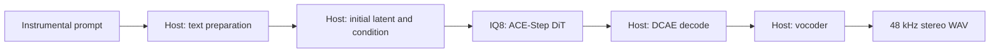

# Deploying ACE-Step Music Generation on a Qualcomm IQ8 NPU

Generative audio is a useful test case for edge AI: it combines a substantial
model, an iterative sampling loop, multiple data representations, and a user
expectation that the output will be both correct and repeatable. Moving only a
small preprocessing stage to an accelerator would not address the dominant
compute cost. Moving everything without an explicit deployment contract makes
the system difficult to debug and maintain.

GesturDJ takes a practical middle path. It runs the 24-block ACE-Step diffusion
transformer (DiT) on the Qualcomm IQ8 NPU, while keeping text preparation,
DCAE decoding, and vocoding on the host. The result is a qualified path for
generating a 10.031021-second stereo WAV from an instrumental prompt.

This article explains the deployment design, the supported operating envelope,
and the workflow for producing an audio file. A companion article,
`ace-step-iq8-npu-validation-guide.md`, explains how the NPU path is validated
before it is used for a generation run.

## Who this is for

This guide is for developers who are already familiar with Python-based model
integration and want to understand the systems work required to run an
iterative generative model on an NPU. It is not a general introduction to music
generation or diffusion models. The focus is the engineering boundary between a
host application and statically qualified NPU contexts.

The current implementation is deliberately constrained. It supports an
instrumental condition and one fixed tensor shape. Those constraints are part
of the design, not omissions: they make the initial accelerator deployment
reproducible and testable.

## ACE-Step model at a glance

ACE-Step is a latent diffusion music-generation pipeline. Rather than denoising
raw audio samples directly, the pipeline works in a compact music-latent space
and converts the final latent representation back into audio after sampling.
The project pipeline assembles four major model components:

| Component | Role in the pipeline | Current GesturDJ placement |
| --- | --- | --- |
| UMT5 text encoder | Converts the prompt into conditioning embeddings. | Host |
| ACE-Step 2D DiT | Predicts the denoising update for the music latent at each sampling step. | IQ8 NPU |
| Music DCAE | Decodes the final latent representation into an audio-domain representation. | Host |
| Music vocoder | Produces the final waveform. | Host |

The **diffusion transformer**, or DiT, is the iterative core of this workflow.
Starting from a noisy latent, the sampler invokes the DiT repeatedly to predict
how the latent should be refined under the text condition. After the requested
number of sampling steps, the DCAE and vocoder turn that result into a playable
WAV. In the qualified path, the DiT is the accelerator target because it is the
large repeated computation inside the sampling loop.

This division also explains why a music-generation deployment cannot be
evaluated solely by whether a waveform exists. The prompt, latent denoising,
latent decode, and waveform synthesis are separate stages. GesturDJ validates
the accelerator-resident DiT explicitly, then retains the established host-side
decode and vocoder stages around it.

## The execution split

ACE-Step has stages with different deployment characteristics. The DiT is the
expensive iterative network, so it is the part that benefits most from NPU
execution. Text preparation, DCAE decoding, and vocoding remain on the host in
the current workflow.



This split has two advantages. First, it focuses NPU integration work on the
compute-heavy part of the pipeline. Second, it preserves the existing host
implementations of the audio decode and vocoder stages, where the workflow is
already established.

The DiT itself is not loaded as one giant graph. It executes as six chained
four-block batches: blocks 0–3, 4–7, 8–11, 12–15, 16–19, and 20–23. The output
`hidden_states` tensor of one batch becomes the input to the next batch. That
chaining is repeated during every denoising step.


Breaking the model into persistent bounded batches makes the accelerator
execution manageable while preserving the model's sequential block order.

## The qualified operating envelope

Static NPU contexts require the live tensors to match the shapes used during
export and qualification. GesturDJ therefore defines the current supported
configuration explicitly.

| Property | Qualified value |
| --- | --- |
| DiT execution | All 24 blocks on the IQ8 NPU |
| NPU partitioning | Six chained batches of four blocks |
| Latent tensor shape | `1 x 108 x 2560` |
| Encoder-condition shape | `1 x 6 x 2560` |
| Conditioning | Instrumental only |
| Supported duration | `10.031021` seconds |
| Quality-run sampling | 27 steps |
| Numerical acceptance gate | Cosine similarity `>= 0.999` per batch |

The fixed six-token encoder condition is important. Lyrics or arbitrary text
can change encoder length, which would no longer match the static contexts.
Instead of reshaping, padding, or silently truncating a live tensor, the bridge
rejects an unsupported input. This fail-closed behavior prevents an apparently
successful run from using an unqualified graph contract.

For edge deployment, a well-defined operating envelope is often more valuable
than a broad but unverifiable feature list. It provides a known duration,
known condition format, known context set, and known numerical validation
target.

## Prerequisites

Before attempting a run, prepare the project and the board connection.

1. Use the ACE-Step environment documented in `ACE-Step/README.md`.
2. Establish the authenticated SSH ControlMaster connection described in
   `ACE-Step/IQ8_SSH_RUNBOOK.md`.
3. Keep IQ8 credentials in environment variables or the authenticated session;
   do not write credentials into scripts, notebooks, or repository files.
4. Confirm that the expected NPU contexts and runner files are present.
5. Check board health before a long run, including the `external abort` count.

The relevant integration files are intentionally easy to locate:

| File | Responsibility |
| --- | --- |
| `data/src/acestep/iq8_npu_bridge.py` | Transfers live tensors through the chained IQ8 contexts. |
| `data/iq8/runner/ace_step_iq8_infer.py` | Orchestrates inference and writes the WAV output. |
| `data/iq8/runner/run_iq8_controlmaster_wav.sh` | Launches an authenticated run from WSL. |
| `IQ8_NPU_WAV_STATUS.md` | Records validated settings and operational checks. |

## Generate a qualified WAV

The following command uses the supported 27-step quality configuration. Replace
the board address and choose a new output filename for each seed.

```bash
cd /mnt/c/Dropbox/DevRel/academy/GesturDJ/ACE-Step
export IQ8_HOST='<board address>'

data/iq8/runner/run_iq8_controlmaster_wav.sh \
  data/outputs/ace_step_iq8_10s_27steps_seed20261120.wav \
  27 \
  20261120
```

The output path matters operationally. A unique filename keeps the generated
artifact tied to its sampling configuration and seed, which makes comparison
and regression investigation substantially easier.

The workflow also supports a four-step smoke run. Use that only to verify the
integration path quickly; use 27 steps for the established quality baseline.
The purpose of the smoke run is to reveal connection, graph-launch, or tensor
handoff failures early, not to replace a quality evaluation.

## What to validate after the run

A WAV file by itself is not evidence that the model executed correctly. After a
long generation run, validate both the audio artifact and the device state.

**Validate the audio artifact**

- Confirm that the file exists at the requested path.
- Verify a stereo, 48 kHz, 16-bit PCM WAV header.
- Confirm the expected `10.031021`-second duration for the fixed-shape path.
- Preserve the output filename, seed, and sampling-step count with the result.

**Validate the device state**

- Check the board for `external abort` events.
- Confirm the runner completed rather than leaving a stale process behind.
- Investigate transport or SSH failures before treating the result as valid.
- Review the per-batch numerical gate results when graph or runtime settings
  have changed.

The current recorded 27-step quality run completed without IQ8 external-abort
events. That is a useful baseline, but each new configuration must be treated
as a new qualification task rather than inheriting the status of an older run.

## Common integration mistakes

### Treating dynamic text as supported

The most tempting mistake is passing lyrics or an arbitrary-length condition
through contexts that were exported for six instrumental tokens. Do not force
the condition into shape. Export and validate a matching context set first.

### Changing one graph component at a time without requalification

Replacing a context binary, modifying graph lifetime behavior, or changing
tensor dimensions can affect numerical output even when the program still
runs. Re-run the full six-batch comparison after any such change.

### Using a smoke result as a quality result

A four-step run is a fast integration check. It does not establish the behavior
of the 27-step quality configuration. Report the sampling steps alongside any
generated example.

### Ignoring board-health signals

An NPU issue can appear outside the Python process. Pair application-level
success checks with the board-health checks in `IQ8_NPU_WAV_STATUS.md`.

## Extending the deployment

The current deployment is a foundation for controlled expansion. To support a
new duration, encoder length, or text-conditioning mode, follow this sequence:

1. Define the new input and output tensor contract.
2. Export static contexts matching that contract.
3. Produce reference outputs for each NPU batch.
4. Compare live NPU results with those references at every batch boundary.
5. Add the configuration to the supported interface only after it passes the
   same numerical and operational gates as the original path.

This approach may look more deliberate than enabling a new option in a host
application, but it is how an edge AI demo becomes a dependable deployment.

## Conclusion

The key result is not simply that ACE-Step can generate a WAV while an IQ8 is
connected. GesturDJ establishes a repeatable deployment contract: the IQ8 runs
the full 24-block DiT in six chained NPU batches, the host runs the surrounding
audio stages, and the entire flow is bounded by fixed shapes and numerical
checks.

Start with the supported instrumental configuration. Once it is reproducible,
expand the model surface one qualified tensor contract at a time.
