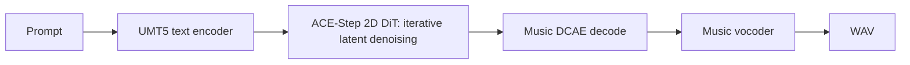
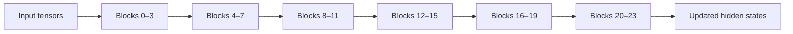

# Validating Chained ACE-Step Inference on a Qualcomm IQ8 NPU

Getting a generative model to execute on an NPU is an important milestone, but
it is not enough to make the output trustworthy. Diffusion pipelines can still
produce an audio file when a tensor has the wrong layout, a context does not
match the expected graph, or an intermediate handoff has drifted numerically.
The output may sound plausible while no longer representing the intended model
calculation.

GesturDJ addresses this problem with a fail-closed validation strategy for its
ACE-Step deployment. The 24-block ACE-Step DiT runs on the Qualcomm IQ8 NPU as
six chained batches. Each batch is compared with a saved reference, and every
batch must meet a cosine-similarity gate of at least `0.999` before the path is
used for WAV generation.

This article explains why chained inference needs batch-level evidence, how the
gate works in practice, and which operational checks complete the validation
story. For the execution architecture and run command, see
`ace-step-iq8-npu-deployment-guide.md`.

## The model stage being validated

ACE-Step is a latent diffusion pipeline for music generation. A UMT5 text
encoder creates prompt-conditioning embeddings, and the ACE-Step 2D diffusion
transformer iteratively denoises a music latent. Once sampling is complete, a
Music DCAE decoder and a music vocoder convert the latent result into the final
waveform.



The validation gate in GesturDJ applies specifically to the DiT stage, which
is the component dispatched to the IQ8 NPU. It does not claim to validate
creative quality or replace normal audio inspection. Instead, it establishes
that the accelerator is producing the expected intermediate latent updates
before the host-side DCAE and vocoder produce an audio artifact.

## Why a single end-to-end check is insufficient

The ACE-Step DiT is partitioned into six persistent four-block NPU batches.
The batch output is passed forward as `hidden_states`, so one incorrect result
can affect every following batch and every later denoising step.



An end-to-end audio check tells a developer that a file was produced. It does
not isolate where a regression began. A batch-level comparison has a much more
useful failure mode: it identifies the earliest NPU partition whose result no
longer agrees with its reference.

That distinction matters when debugging an edge deployment. A failure may come
from a graph export, a context binary, tensor ordering, shape handling, runtime
lifecycle behavior, or the host-to-NPU bridge. The earlier the failure is
located, the smaller the search space.

## The validation contract

The current ACE-Step path is qualified for a fixed input contract.

| Input or policy | Qualified value |
| --- | --- |
| Latent shape | `1 x 108 x 2560` |
| Encoder-condition shape | `1 x 6 x 2560` |
| Condition type | Instrumental |
| Audio duration | `10.031021` seconds |
| DiT partitions | Six chained four-block batches |
| Acceptance threshold | Cosine similarity `>= 0.999` for each batch |

The bridge rejects unsupported tensor sizes instead of attempting a best-effort
conversion. This behavior is central to validation: a comparison is meaningful
only when the live NPU input has the same interpretation as the reference
input. Padding, truncating, or reshaping a condition merely to satisfy a graph
would undermine that assumption.

## What cosine similarity measures here

Cosine similarity compares the direction of two flattened output tensors. A
score close to `1.0` indicates that the NPU result and the saved reference agree
closely in direction. GesturDJ uses the comparison as a practical numerical
gate at each NPU batch boundary.

```text
reference batch output  ─┐
                         ├─ cosine similarity ─> pass if >= 0.999
live IQ8 batch output   ─┘
```

The threshold does not claim that every element is bit-identical across two
execution environments. It sets a strict, repeatable acceptance criterion for
the qualified pipeline. A value below the threshold means the configuration is
not accepted for a WAV generation run until the discrepancy is understood.

This is stronger than inspecting the final audio alone. Subjective listening is
still useful when evaluating creative quality, but it is not a substitute for
verifying the numerical path that produced the audio.

## Recorded evidence for the current path

The repository records the final comparison for each four-block batch in
`ACE-Step/IQ8_NPU_WAV_STATUS.md`.

| Blocks | Recorded final cosine | Result |
| --- | ---: | --- |
| 0–3 | `0.9999539421` | Pass |
| 4–7 | `0.9998565466` | Pass |
| 8–11 | `0.9998298288` | Pass |
| 12–15 | `0.9997063599` | Pass |
| 16–19 | `0.9997924376` | Pass |
| 20–23, with replacement block 22 | `0.9999190429` | Pass |

All of the recorded values exceed the `0.999` gate. The final partition has a
special implementation detail: block 22 uses a scale-32 replacement context.
Rather than exempting that block from validation, the workflow validates it
independently as well. Its recorded single-block gate is `0.9999998830` cosine.

This is the right way to handle an exceptional context: make the exception
visible, give it its own evidence, and keep it inside the same acceptance
policy as the rest of the system.

## Fail closed before decoding audio

The NPU bridge follows a simple rule:

```text
All tensor checks pass and every batch reaches the gate
    -> allow host-side DCAE decode and vocoding

Any tensor check or batch gate fails
    -> stop the run and investigate
```

Failing closed avoids a subtle but common issue in generative systems. A
downstream decoder and vocoder can often turn almost any latent-like array into
an audio artifact. A playable WAV is therefore evidence of file production,
not necessarily evidence of correct inference. The gate separates those two
concepts.

This policy also protects reproducibility. If a configuration cannot meet the
recorded numerical contract, it is not silently added to the supported path.
It remains an experiment until it is exported, measured, and qualified.

## A practical validation workflow

Use the following workflow whenever a context, graph lifecycle setting, bridge
implementation, or input contract changes.

### 1. Start from a controlled input

Use the qualified latent and instrumental encoder-condition shapes. Keep the
sampling configuration and seed recorded with the run. If the test changes
multiple variables at once, a failed comparison becomes much harder to explain.

### 2. Capture or load the correct reference

Reference outputs must correspond to the exact batch and input contract under
test. A reference created for another context version or tensor layout is not a
valid comparator, even if the dimensions happen to match.

### 3. Compare after every NPU batch

Dispatch the first four-block context, compare its output, then pass the
validated output forward to the next batch. Record the cosine score, batch
identity, context version, and result. Stop at the first failure.

### 4. Investigate the smallest failing boundary

If blocks 0–3 pass and blocks 4–7 fail, begin with the second context and its
input handoff. Check tensor order, dtype and layout expectations, context
selection, and runtime initialization before changing unrelated model stages.

### 5. Permit a long generation run only after the gate passes

Once all six batches pass, use the 27-step configuration for the established
quality run. A four-step run remains useful for integration smoke testing, but
it is not a replacement for the quality configuration.

## Operational checks complete the picture

Numerical comparison verifies model behavior; it does not verify every aspect
of board health. Long-running NPU work also needs operational checks before and
after the generation run.

**Before the run**

- Confirm that the SSH connection is available and authenticated.
- Check for a stale NPU runner from an earlier attempt.
- Check the current IQ8 `external abort` count.
- Confirm the intended context binaries, seed, and output path.

**After the run**

- Verify the WAV header: stereo, 48 kHz, and 16-bit PCM.
- Confirm the fixed-shape output duration of `10.031021` seconds.
- Check that no IQ8 external-abort event was recorded during the run.
- Preserve the command configuration and numerical-gate results with the
  output artifact.

The recorded 27-step baseline completed with zero external-abort events. Treat
that as evidence for the recorded configuration, not as a blanket guarantee for
future changes. Any new context, runtime, or tensor contract needs its own
validation record.

## When requalification is mandatory

Re-run the complete validation process when any of the following changes:

- A DiT block or static NPU context is re-exported.
- The replacement block-22 context is changed.
- NPU graph lifecycle or persistent-server behavior changes.
- The host-to-IQ8 bridge changes tensor preparation or dispatch behavior.
- A new condition length, lyric mode, or audio duration is introduced.
- A runtime upgrade could alter numerical execution.

The principle is straightforward: if a change could alter the tensor values,
the existing evidence no longer proves the behavior of the modified path.

## From demo to dependable edge AI

The lesson applies beyond music generation. Partitioning a model across several
accelerator contexts can make an otherwise impractical deployment possible,
but it also introduces interfaces that must be treated as first-class
correctness boundaries. Validate those boundaries explicitly, record the
evidence, and stop rather than producing an unqualified artifact.

For GesturDJ, this process turns chained ACE-Step inference on the IQ8 from a
single successful run into a controlled and repeatable workflow. The precise
current evidence and operational runbook are maintained in
`ACE-Step/IQ8_NPU_WAV_STATUS.md`.
