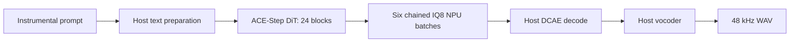

# ACE-Step on IQ8: Generating a Music WAV with a Chained NPU DiT

GesturDJ now uses ACE-Step as its music model. The implementation keeps the
audio front and back ends on the host, while the IQ8 executes the expensive
24-block diffusion transformer on its NPU.

## What runs where



The DiT is too large to keep as one resident graph, so the deployment uses six
four-block context batches. The output of each batch becomes the
`hidden_states` input to the next batch. Every batch is compared with a saved
reference and must meet cosine similarity `>= 0.999` before it is used live.

## The validated result

The current quality baseline is a 10.031021-second instrumental WAV generated
with 27 denoising steps and seed `20261119`:

```text
ACE-Step/data/outputs/ace_step_iq8_10s_27steps_seed20261119.wav
```

The output is stereo, 48 kHz, 16-bit PCM. The IQ8 completed the full run with
zero recorded external-abort events.

## Why the demo is intentionally fixed-shape

The qualified IQ8 contexts accept a latent shape of `1 x 108 x 2560` and an
instrumental encoder condition of `1 x 6 x 2560`. That maps to exactly
10.031021 seconds. A lyric-bearing or variable-length prompt changes the
encoder sequence and is rejected by the bridge rather than silently producing
incorrect output.

This is the right trade-off for a first trustworthy edge deployment: a small,
reproducible operating envelope with hard numerical gates. Future work can add
new static context sets for additional conditioning lengths, then qualify each
one with the same end-to-end batch checks.

## Run it responsibly

Board credentials stay in environment variables. Check board health before a
long run, use a fresh output filename for each seed, and verify both the WAV
header and `external abort` count afterward. See the repository’s
`ACE-Step/README.md` and `ACE-Step/IQ8_NPU_WAV_STATUS.md` for the exact
workflow.
