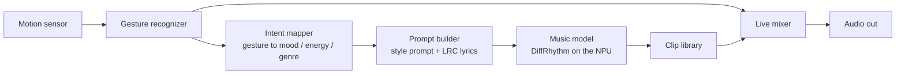
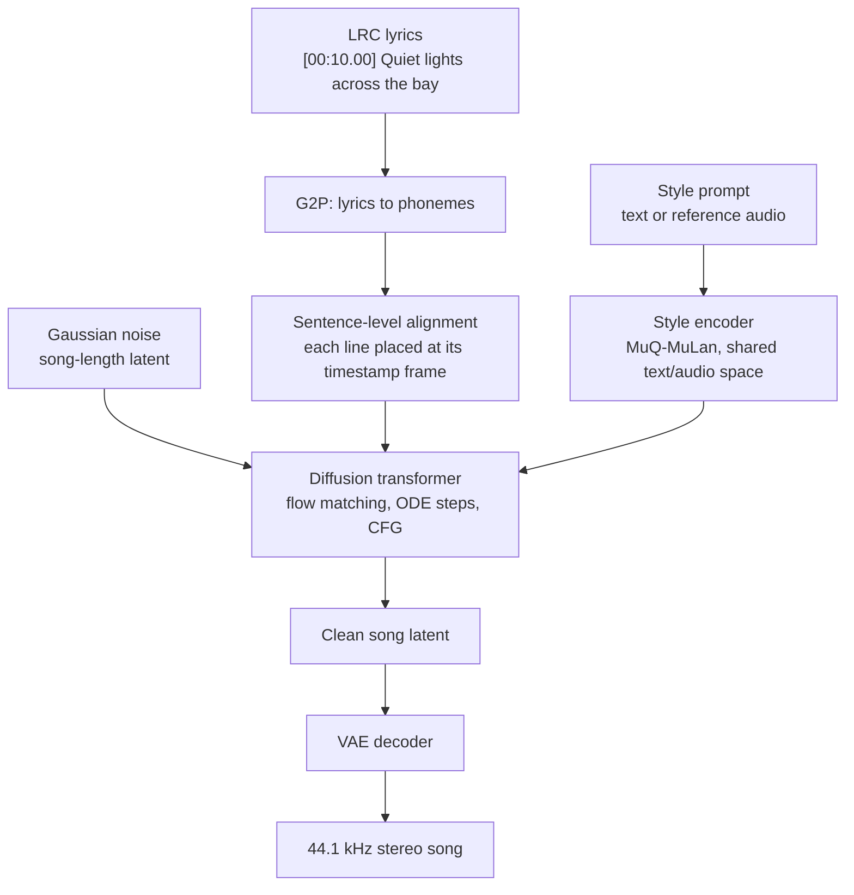

# From Gesture to Groove: Why We Chose DiffRhythm for GesturDJ on Arduino Ventuno Q

> **TL;DR** We wanted a board that turns a wave of your hand into a real song: vocals, accompaniment and structure, generated locally. We compared the main open text-to-music and lyrics-to-song models and picked **DiffRhythm**. It is open, it is not autoregressive, it builds a whole song in a fixed number of passes, and it takes the two inputs a gesture system can produce cleanly: a **style prompt** and **timed lyrics**. Then we split its transformer into four pieces to run it on the NPU. One note up front: every number in this post was measured on a Dragonwing IQ8 development board, the same chip as the one inside the Arduino Ventuno Q. The Ventuno Q run itself is next.

## The idea: your hands are the DJ controller

Most generative music demos stop at "type a prompt, wait, listen." That is fine in a browser. We build for **Physical AI**, where devices sense, decide and act. On an edge board, the prompt should not be typed. It should be performed.

So the GesturDJ loop looks like this. A motion sensor (a camera path is planned) feeds a small recognizer that classifies the gesture. The gesture becomes a musical intent: mood, energy, genre. That intent becomes a style prompt and lyrics, a music model renders the audio on the device, and the board plays it. You react and gesture again.



Notice the split. Generating a song takes minutes, so it cannot be live. **Gesture-to-music is a mixing problem sitting on top of a generation problem.** The recognizer and the mixer run on the live path. The song model fills a clip library in the background.

The hard part is not the sensor or the speaker. It is choosing the model: **which one turns intent into music well enough, fast enough, and with a license we can teach with?**

## Gesture to music is not a model

We did not find an open model that takes a gesture and returns music. What exists is two patterns. Either the gesture drives controls on something else (a mixer, a synth, a clip player), or it steers a generator that streams audio continuously. Google's Magenta RealTime 2 is the open example of the second: text prompts and note control on a model that generates faster than playback, with the real-time claim made for Apple Silicon.

## Two families, three designs

Text-to-music models split first by what you give them.

| Family | You give it | You get | Use |
| --- | --- | --- | --- |
| Text-to-music (MusicGen, AudioLDM2, Stable Audio Open) | A description: "lofi piano, rainy night" | Instrumental clips, usually short | Loops, beds, sound design |
| Lyrics-to-song (DiffRhythm, ACE-Step, YuE, SongGeneration) | Lyrics plus a style | A full song with vocals and accompaniment | Complete tracks with structure |

For a performance, not a background loop, we needed the second family, with one condition: it had to do pure instrumental output too, for gestures that mean "just vibe."

Then they split by design, and the design decides whether an NPU can run them.

**Autoregressive over codec tokens.** A language model predicts discrete audio tokens one at a time. MusicGen uses a 32 kHz EnCodec tokenizer with four codebooks at 50 Hz and a delay pattern, which still means 50 autoregressive steps per second of audio. A 45 second clip is about 2,250 sequential steps with a cache that grows at every one. YuE belongs here too; its newest version is a 3B model that asks for a 24 GB GPU.

**Latent diffusion or flow.** The audio is compressed into a latent sequence and a transformer refines the whole thing, again and again, from noise. Stable Audio Open does this for up to 47 seconds of stereo audio and says on its model card that it cannot generate realistic vocals. DiffRhythm and ACE-Step do it for full songs with lyrics.

**Streaming.** Short chunks, generated ahead of playback, steerable while they play. Magenta RealTime is the one to watch if your goal is live control.

The line that matters for an NPU: **an autoregressive model is a long chain of small dependent steps with a growing cache. A diffusion model is one fixed-size tensor pushed through the same network N times.** The first is a latency problem and a dynamic-shape problem. The second compiles once.

## How we evaluated the models

Our baseline was MusicGen-Small, the model most developers try first. Then we went through the replacement candidates.

We ranked the criteria, in this order:

1. **License clarity.** We publish curriculum and reference code for external developers. We need permissive licenses, not "check with legal first."
2. **Full-song capability.** Vocals and accompaniment together, with real structure.
3. **Inference style.** Non-autoregressive is a big advantage on edge hardware.
4. **Controllability from a gesture.** Can a small structured signal drive the output?
5. **Integration effort.** How much plumbing sits between `pip install` and sound?
6. **Output quality** in our own listening.

Here is how the open candidates line up, using what their own pages and papers say.

| Model | Design | Lyrics and vocals | Length | License | Notes |
| --- | --- | --- | --- | --- | --- |
| MusicGen | Autoregressive, 50 steps per second of audio | Text and melody conditioning; no lyrics documented | Not stated on its page | Code MIT; weights CC-BY-NC 4.0 | Weights are non-commercial |
| Stable Audio Open | Latent diffusion (DiT) | Cannot make realistic vocals | Up to 47 s | Stability AI Community License | Commercial use under Stability's terms |
| YuE 2 | AR plus NAR hybrid, 3B | Yes | Not stated | Code Apache-2.0; weights CC BY-NC 4.0 with additional creator permission | 24 GB GPU; companies need a commercial license |
| ACE-Step | Flow matching, linear transformer | Yes, 19 languages | Up to 4 min | Apache-2.0 | 4 min in about 20 s on an A100 |
| Magenta RealTime 2 | Streaming | Text prompts and note control | Continuous | Code Apache-2.0; weights CC-BY 4.0 | Real-time on Apple Silicon; trained mostly on instrumental stock music |
| **DiffRhythm** | Latent flow matching, 16-layer DiT | Yes (style prompt + LRC) | 95 s or 4 min 45 | Code and DiT weights Apache-2.0; VAE under the Stability AI Community License; MuQ-MuLan style weights CC-BY-NC-4.0 | Three licenses in one pipeline: review each before product use |

What we learned from trying them:

AudioLDM2 is the easiest drop-in for MusicGen: same Diffusers pattern, text in, audio out. It is great for a quick instrumental demo and it is not a song generator. Stable Audio Open sounds good for loops and effects, but it caps clip length, it cannot do realistic vocals, and its license is revenue-gated, which is friction for a public curriculum. YuE, Khala and SongGeneration are capable, and each brings real setup weight: large checkpoints, Docker plus big GPUs, or a different input contract.

ACE-Step looked very promising on paper. It is Apache-2.0, claims comparable speed, and its authors argue that diffusion models like DiffRhythm lack long-range structure. In our own listening tests on this project, the output quality was not where we needed it for a demo that has to impress in five seconds.

## Why DiffRhythm won

**A license we can teach with.** DiffRhythm's code and DiT weights are Apache-2.0. One nuance every developer should know: the VAE is fine-tuned from Stable Audio Open, so `DiffRhythm-vae` is subject to the Stability AI Community License. And the MuQ-MuLan style-encoder weights are CC-BY-NC-4.0, evaluation only. Reading the license of every checkpoint in your pipeline is a habit worth building, and a licensing review is a must before any product use.

**It is simple by design.** The authors call it "blazingly fast and embarrassingly simple." No multi-stage cascade, no separate vocal and accompaniment models stitched together. It needs only lyrics and a style prompt. Fewer moving parts means fewer things break on a board.

**Its shape fits an NPU.** Fixed tensor, repeated passes, 16 identical blocks. We could split it at block boundaries and compile each piece once.

**It has speed headroom.** The paper measures a real-time factor of 0.034 to 0.037 on an RTX 4090, against 1.717 for SongLM, about 50 times faster. A board far slower than a 4090 still lands in minutes.

**Its input contract matches gestures.** A recognizer outputs a handful of discrete states plus an intensity. That maps to a style string like `"lofi, piano, rain, calm, instrumental"` and an LRC lyric template. No prompt-engineering marathon. It also supports an instrumental mode, and v1.2 added song editing and continuation, which opens the door to a "keep the beat, change the vibe" gesture later.

The honest part: **we chose DiffRhythm because it fit the hardware and the job, not because we proved it sounds best.** DiffRhythm's own table has SongLM ahead on FAD and musicality, with DiffRhythm ahead on intelligibility and speed. We have not run a head-to-head listening study.

## How DiffRhythm works inside

DiffRhythm is a latent diffusion model for songs. It does not generate raw samples. It generates a compact latent for the whole song and decodes it to a stereo waveform.



**The VAE** (derived from Stable Audio 2) compresses 44.1 kHz stereo into 64-dimensional latents at 21.5 frames per second. In a latent diffusion system the VAE sets your audio-quality ceiling and your sequence length. Shorter latents mean cheaper diffusion, which is why full songs are feasible at all.

**The lyrics trick is the surprise.** There is no word-level alignment. The model builds a sequence the length of the latent, fills it with padding, and writes each sentence's phonemes into it starting at that sentence's timestamp. That is all. The paper reports that cross-attention and direct concatenation of text features did not give intelligible vocals, and that without this alignment intelligibility could not even be measured.

**The style prompt** goes through MuQ-MuLan, a joint music-text embedding. Text and audio share a space, so you can condition on `"Jazzy Nightclub Vibe"` or on a short reference clip. For GesturDJ, text is the obvious fit.

**The DiT** is a 16-layer LLaMA-style transformer, 2048 hidden size, about 1.1 billion parameters, trained with conditional flow matching on about a million songs: first at 95 seconds, then fine-tuned to 4 minutes 45. At inference an ODE solver integrates a predicted velocity over a fixed number of steps (32 in the paper, 16 in our runs), and classifier-free guidance doubles the cost of each step. So a song is 30 to 62 passes through the same 16 blocks, and every pass touches all frames at once.

| Variant | Length | Notes |
| --- | --- | --- |
| DiffRhythm-base | about 1m35s | Our default: shorter, lighter, faster turnaround |
| DiffRhythm-full | about 4m45s | Full-length songs |
| DiffRhythm-vae | n/a | Shared VAE, Stability AI Community License |
| v1.2 | n/a | Less lyric repetition and omission, better arrangement, editing and continuation |

The same lab has since published DiffRhythm+ (multimodal style conditioning from text and reference audio, preference optimization) and DiffRhythm 2. Both are worth watching.

## Wiring gestures to the prompt

The idea is deliberately simple. The gesture picks the vibe and a template supplies the words.

```python
# Gesture state -> style prompt (example labels)
GESTURE_STYLES = {
    "open_palm": "lofi, piano, rain, calm, instrumental.",
    "fist_pump": "edm, energetic, synth, festival, driving beat.",
    "point_up":  "pop, uplifting, bright vocals, catchy chorus.",
    "rock_sign": "rock, electric guitar, drums, powerful vocals.",
}

# No empty-text lines: DiffRhythm's G2P raises "Unknown language" on an empty lyric line.
LYRICS_LRC = """[00:10.00]Quiet lights across the bay
[00:16.00]Edge devices dream all day
[00:22.00]Little chips that learn to sing
[00:28.00]Music made from everything"""
```

Two gotchas cost us time. A blank line in the LRC breaks G2P, so strip empty lines first. And DiffRhythm does not sing the last lyric line, because it marks the end, so add a throwaway final line.

## Getting the transformer onto the NPU

The full 16-block graph reset our board during HTP prepare, about six minutes in. It was not out-of-memory. The fault is in the kernel on a freshly allocated page, and a plain `stress-ng` run reproduces it on a clean image with no model involved. The stock 95 second fp16 graphs reset the board on 2 of 2 loads; the 45 second graphs and the mixed 95 second graphs loaded six times each with no reset. That is an open issue with the board owners.

The workaround became the design. We split the DiT into four graphs of four blocks, compiled each once into a context binary that reloads in seconds, and wrote a small C++ server that keeps all four resident and chains them by tensor name. Prepare used to cost minutes per launch. Now it costs seconds per session.

The first chained output had a cosine of 0.06 against the PyTorch reference. The culprit was Mish: its Softplus is wrong in fp16 on HTP v75 for large negative inputs. Rewriting it as `x * tanh(softplus(clamp(x, -10, 10)))` fixed it, and no tool warned us. We only saw it because we compare against a reference before we generate any audio.

Then quantization. **All-int8 fails: cosine 0.61 on the 95 second graphs, 0.76 on the 45 second ones.** The ends of the network are sensitive and the middle is not. Quantizing only the middle two graphs to int8 weights with 16-bit activations, calibrated on real captured inputs, scores 0.99986, against 0.99999 for all-fp16, and it is faster.

| 44.6 second song, 16 steps | Mixed int8 | All fp16 |
| --- | --- | --- |
| NPU time per pass | 2.5 s | 3.7 s |
| NPU time per song | 81 s | 113 s |
| Cosine vs fp32 | 0.99986 | 0.99999 |

The whole song takes four to six minutes. The NPU is a steady 81 of those seconds; the rest is the PC running the text and style encoders and the audio decoder. We did not run a listening study, and DiffRhythm was trained on 95 second songs, so listen before you trust 45 seconds.

## The part that is not the model

Once the song model ran, the latency that decided whether a gesture felt live was not in it. It was in the audio output. Starting a player for every gesture put the first sound at 236 to 280 ms on this board, over a 200 ms budget by itself. Keeping one output stream open and swapping clips into it brought the estimated total to about 113 ms. That deserves its own post.

## Common misconceptions

**"Text to music is one kind of model"** → It is at least three designs, and an autoregressive one is a very different workload for an NPU than a diffusion one.

**"The NPU is the hard part"** → The compiler, the memory and one activation function were.

**"int8 everywhere is the point of an NPU"** → Not here. The ends stay fp16, and a cosine gate tells you before you waste a song.

## Responsible use

DiffRhythm's authors are clear about the risks: unintended stylistic similarity to copyrighted works, careless blending of cultural styles, and misuse. In GesturDJ we label all output as AI-generated, avoid prompting for specific artists, and keep lyrics original (ours come from simple templates). If you build on this, do the same.

## License check before you demo

DiffRhythm is three licenses in one pipeline. Check each before you show it to anyone outside the team. This is a summary, not legal advice.

| Piece | License | What it means for a demo |
| --- | --- | --- |
| DiffRhythm code and DiT weights | Apache-2.0 | Free to use, modify and publish. |
| VAE (`DiffRhythm-vae`) | Stability AI Community License | Free for non-commercial use. Commercial use is gated by company revenue, so a large company needs an agreement with Stability. Check the current terms at stability.ai/license. |
| MuQ-MuLan style-encoder weights | CC-BY-NC-4.0 | Non-commercial only: evaluation, research, internal use. |

**Internal or closed-door demo** (team reviews, evaluation): go ahead.

**Public, customer-facing or event demo:** get legal sign-off first. A promotional demo can count as commercial use even when nothing is sold. Label it as an evaluation, not a product path.

**Do not redistribute the MuQ-MuLan or VAE weights.** Point readers to their original sources, which is how our notebook gets them.

**If legal says no:** swap the model (ACE-Step's code and weights are Apache-2.0; in our listening it fell short of what a demo needs), or ask the DiffRhythm authors (ASLP lab) for permission to use the style encoder commercially. Either costs time, so ask early if the demo has a date.

Label all generated output as AI-generated.

## Where it stands on the Arduino Ventuno Q

The Arduino Ventuno Q is built on the Dragonwing IQ8 family, so the HTP v75 graphs are the starting point there. Every measurement above comes from a Dragonwing IQ8 development board, the chip inside the Arduino Ventuno Q. We have not run any of it on a Ventuno Q, so that is the next step, not a result. It runs Ubuntu where our board runs Qualcomm Linux, and the memory fault is a property of the board we used. Load the graphs and run the gate yourself before you trust a song.

The scripts, the notebook and the gates are in the repo: [repo link]. The step-by-step build is in the companion post.

## References

- Ning et al., *DiffRhythm: Blazingly Fast and Embarrassingly Simple End-to-End Full-Length Song Generation with Latent Diffusion*, arXiv:2503.01183. https://arxiv.org/abs/2503.01183
- ASLP-lab/DiffRhythm on GitHub. https://github.com/ASLP-lab/DiffRhythm
- Model cards: [DiffRhythm-base](https://huggingface.co/ASLP-lab/DiffRhythm-base), [DiffRhythm-full](https://huggingface.co/ASLP-lab/DiffRhythm-full), [DiffRhythm-vae](https://huggingface.co/ASLP-lab/DiffRhythm-vae)
- *DiffRhythm+: Controllable and Flexible Full-Length Song Generation with Preference Optimization*, arXiv:2507.12890. https://arxiv.org/abs/2507.12890
- ACE-Step. https://github.com/ace-step/ACE-Step
- YuE. https://github.com/multimodal-art-projection/YuE
- Stable Audio Open 1.0. https://huggingface.co/stabilityai/stable-audio-open-1.0
- Magenta RealTime. https://github.com/magenta/magenta-realtime
