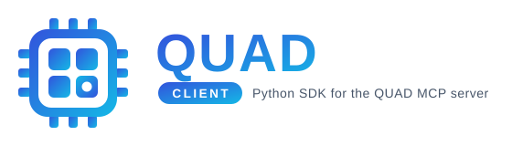

<p align="center">
  
</p>

# QUAD-Client

> **Python SDK + sample apps that connect to a QUAD Qualcomm AI MCP server.**
> Install the client, point it at a QUAD MCP server, and run a CPU vs NPU
> benchmark on Snapdragon X Elite in minutes.

[](https://pypi.org/project/quad-mcp-client/)
[]()
[]()
[]()
[]()

---

## Quick start

QUAD-Client is the **client** half of QUAD: it provisions your coding agent
(Claude Code by default) and sample scripts to talk to a QUAD MCP server. The
server is provided to you separately — as a hosted (`sse-http`) endpoint, a
remote machine you reach over SSH, or one already installed on this machine.
You only need its **URL** (and a token, if it requires auth).

### Step 1 — Clone and install the client

```powershell
git clone https://github.com/CBN-AI-TEAM/QUAD-Client.git
cd QUAD-Client
.\install.ps1
```

On macOS / Linux (or Git Bash on Windows) run `./install.sh` instead. The
installer asks which transport to use and where the QUAD MCP server lives,
runs a connection probe, then writes the config and launches your agent.

> **Using a hosted (`sse-http`) MCP server with auth?** Export
> `QUAD_MCP_TOKEN` in the *same shell* you run `install.ps1` / `install.sh`
> from. The installer auto-detects it and skips the token prompt; without
> it you'll be prompted (or, if the server requires auth, the connection
> probe will fail with HTTP 401). For `stdio-local` and `stdio-ssh`, skip
> this step.
>
> **Windows (PowerShell)**
> ```powershell
> # current session only
> $env:QUAD_MCP_TOKEN = "paste-your-token-here"
> # persist for future sessions (user-level)
> [System.Environment]::SetEnvironmentVariable("QUAD_MCP_TOKEN", "paste-your-token-here", "User")
> ```
>
> **Linux (bash / zsh)**
> ```bash
> # current session only
> export QUAD_MCP_TOKEN="paste-your-token-here"
> # persist: add the same line to ~/.bashrc or ~/.zshrc, then `source` it
> ```
>
> **macOS (zsh, the default since Catalina)**
> ```bash
> # current session only
> export QUAD_MCP_TOKEN="paste-your-token-here"
> # persist: add the same line to ~/.zshrc, then `source ~/.zshrc`
> ```
>
> Verify it's set before running the installer:
> ```bash
> # bash / zsh
> echo "$QUAD_MCP_TOKEN"
> # PowerShell
> echo $env:QUAD_MCP_TOKEN
> ```

The installer provisions the client and then launches **Claude Code** by default.
To launch a different CLI coding agent, choose it with (highest priority first):

```bash
./install.sh --agent opencode                 # 1. CLI flag (this run only)
QUAD_CLIENT_DEFAULT_AGENT=codex ./install.sh   # 2. environment variable
# 3. quad-client.toml:  default_agent = "opencode"   (persistent default)
./install.sh                                   # 4. nothing set → Claude Code
```

Allowed values: `claude` | `opencode` | `codex`. opencode/codex **fall back to
Claude Code** if not installed or they fail to launch. Use `--no-launch` to
finish setup without starting any agent. (Copy `quad-client.toml.example` to
`quad-client.toml` to set a persistent default.)

#### Which agent should I choose — Claude Code or opencode?

Both drive the **same** QUAD MCP tools, the **same** `.claude/skills/**/SKILL.md`
files, and the **same** `CLAUDE.md` context — so you can switch at any time with
no loss of functionality. The difference is in the host CLI:

| | **Claude Code** (default) | **opencode** |
|---|---|---|
| Source | Proprietary (Anthropic) | Open source |
| Model | Claude | Bring your own (any supported provider) |
| Setup effort | Zero — the primary, tested path for QUAD | Zero — reuses Claude Code's config; `opencode.json` is written when selected |
| Config file | `.claude/settings.json` (MCP tools pre-approved) | `opencode.json` (MCP server + `instructions: ["CLAUDE.md"]`) |
| Skills | Auto-discovered as slash commands (e.g. `/quad-quickstart`) | Same `SKILL.md` files, invoked by asking in natural language **or** via generated `/quad-*` slash commands |
| QUAD MCP tools | Pre-approved in `settings.json` | Discovered at runtime |

**Rule of thumb:**

- **Choose Claude Code** (just run `./install.sh`) if you want the supported,
  batteries-included experience — it's the path every sample and doc is tested
  against.
- **Choose opencode** (`./install.sh --agent opencode`) if you prefer an
  open-source CLI or want to run a non-Claude model provider. Everything QUAD
  installs is shared, so nothing else changes.

When you select **opencode**, the installer also writes an `opencode.json`
(MCP server + `instructions: ["CLAUDE.md"]`) and generates a
`.opencode/commands/quad-*.md` file per skill. opencode reuses the **same**
`.claude/skills/**/SKILL.md` files Claude Code uses, and discovers the QUAD MCP
tools at runtime — so updating a skill or adding an MCP tool needs no
reprovisioning. Provision opencode explicitly any time with:

```bash
quad-client install --client opencode
```

> **How to run a skill in opencode.** opencode treats skills differently from
> Claude Code. There are two ways to invoke a `quad-*` skill:
>
> 1. **Just ask in natural language** — e.g. *"what hardware do I have?"* or
>    *"convert mobilenetv2 to INT8"*. opencode loads skills as model-invoked
>    tools and picks the right one from its description. (Skills alone do **not**
>    appear in the `/` slash menu.)
> 2. **Type the slash command** — `/quad-detect`, `/quad-convert`, etc. These
>    come from the generated `.opencode/commands/` files and each just invokes
>    the matching skill. Restart opencode after install so it loads them.


### Step 3 — Verify the connection

In your agent (e.g. Claude Code), just ask:

> *"Is this client connected to the MCP server?"*

The agent runs the QUAD MCP tools and reports the server status. You can also
verify from the CLI without writing any config:

```bash
quad-client status         # show the configured transport + server
quad-client connect-test sse-http --sse-url "https://your-server/mcp"
```

### Step 4 — Run the MobileNetV2 sample

```powershell
cd samples\mobilenetv2
.\run.ps1                                               # install sample deps (numpy, onnxruntime, etc.)
.venv\Scripts\python.exe run_mobilenetv2.py --image cat.jpg   # download, convert, benchmark
```

That's it. The script:
1. **Downloads** MobileNetV2 from the ONNX Model Zoo
2. **Converts** the model to QNN DLC via the QUAD MCP server
3. **Benchmarks** CPU (onnxruntime) vs NPU (QNN HTP on Hexagon) and prints a comparison

### Expected output

```
COMPARISON — CPU (onnxruntime) vs NPU (QNN HTP)

  Metric                             CPU (onnxruntime)           NPU (QNN HTP)
  ──────────────────────────────────────────────────────────────────────────────
  Avg latency                                   6.4 ms                 5.48 ms
  Min latency                                   4.6 ms                 5.48 ms
  Throughput                                   157 FPS                 183 FPS
  Speedup                                         1.0×                    1.2×
  Iterations                                        10                    1826
  ──────────────────────────────────────────────────────────────────────────────
  Avg CPU util                                     47%         ~0% (offloaded)
  Est. pkg power                               ~10.7 W                  ~4.5 W

  Top-5 predictions (NPU):
    1. golden retriever                  52.3%
    2. Labrador retriever                33.1%
    ...
```

> The NPU runs at **~half the power** of the CPU for equivalent throughput.
> On models larger than MobileNetV2 (ResNet-50, YOLO, LLMs), the NPU speedup is more pronounced.

---

## How it connects

QUAD-Client doesn't run inference itself — it provisions your coding agent and
sample scripts to call a QUAD MCP server over one of three transports. You pick
the transport at install time based on where the server lives:

```
┌──────────────────────────────────┐
│  Claude Code / opencode / codex  │        ┌─────────────────────────┐
│  + samples (run_mobilenetv2.py)  │──MCP──▶│   QUAD MCP server        │
│  (QUAD-Client — this repo)       │        │   (hosted / SSH / local) │
└──────────────────────────────────┘        └─────────────────────────┘
```

| Transport | Where the server runs | You provide |
|---|---|---|
| **`sse-http`** | A hosted HTTP/SSE endpoint | the server URL (+ token if it needs auth) |
| **`stdio-ssh`** | A remote machine you reach over SSH | `user@host` (key-based SSH) |
| **`stdio-local`** | Already installed on this machine | nothing — the agent launches it |

The installer probes your chosen transport **before** writing any config, so a
bad URL or token is caught immediately. See
[`docs/TRANSPORTS.md`](docs/TRANSPORTS.md) for the full walkthrough.

---

## What gets installed?

A small (~6 MB) Python package plus your agent's config — nothing heavyweight:

| File | Purpose | Size |
|---|---|---|
| `quad_mcp_client` Python package | MCP client, QNN inference utils, connection probes | ~80 KB |
| `typer` + `httpx` (the only deps) | CLI framework + HTTP client for SSE probe | ~5 MB |
| `.claude/settings.json` | Tells Claude Code where the QUAD MCP server is | ~1 KB |
| `.claude/skills/quad-*.md` | 17 bundled skill files (quickstart, detect, convert, profile, ...) | ~70 KB |

The sample scripts under `samples/` install their own dependencies on demand
via each sample's `run.ps1` (numpy, onnxruntime, Pillow, ...).

---

## Python SDK (programmatic access)

Beyond provisioning an IDE, QUAD-Client ships a typed **`QuadClient`** SDK for
calling the six QUAD MCP tools directly from Python. It resolves the transport
automatically (explicit args → `QUAD_MCP_URL`/`QUAD_MCP_TOKEN` → a discovered
`.claude/settings.json` → a local server spawn), retries transient failures
with exponential backoff, supports bearer-token + mTLS auth for hosted
servers, and tolerates both MCP result-envelope shapes.

```python
from quad_mcp_client import create_client

async def main() -> None:
    # No args → auto-resolve the server. Or: create_client(url=..., token=...)
    async with create_client() as client:
        hw = await client.hardware_detect(platform="windows")
        conv = await client.convert_model(
            source_format="onnx", model_path="mobilenetv2.onnx",
            target_sdk="qnn", quantization="int8",
        )
        prof = await client.profile_workload(
            model_path=conv["output_path"], platform="windows", runtime="npu",
        )
        print(prof["latency"]["mean_ms"], "ms")

        # Pagination helper for the AI Hub Models catalog:
        async for model in client.search_aihub("mobilenet", max_results=10):
            print(model["id"])
```

Typed methods (`hardware_detect`, `convert_model`, `profile_workload`,
`orchestrate_workload`, `generate_code`, `aihub_select`) return parsed dicts;
`call_tool(name, args)` gives the raw MCP result for advanced use. Tune
resilience + auth with `create_client(retry=RetryPolicy(...), auth=ClientAuth(...))`.

> The SDK uses `fastmcp` lazily — install it via `pip install
> quad-mcp-client[samples]` (or `pip install fastmcp`). The core provisioner
> package stays lightweight (typer + httpx) for IDE setup.

---

## Samples

### MobileNetV2 — CPU vs NPU Benchmark

**`samples/mobilenetv2/`** — Full pipeline: download ONNX model, convert via MCP server, benchmark on Snapdragon X Elite.

```powershell
cd samples\mobilenetv2
.\run.ps1
.venv\Scripts\python.exe run_mobilenetv2.py --image my_photo.jpg --skip-download
```

Key flags:
- `--skip-download` — skip model download if already cached
- `--runs 10` — number of CPU benchmark iterations (default: 10)
- `--warmup 3` — CPU warmup iterations (default: 3)
- `--adapter-mode mock` — use mock adapter (no SDK needed, simulated conversion)
- `--server http://host:8080/sse` — connect to a remote QUAD server instead of local subprocess

---

## CLI reference

```
quad-client install        # provision + connection-test
quad-client status         # what's installed
quad-client preview        # print settings.json without writing
quad-client uninstall      # remove bundled skills
quad-client connect-test   # verify a transport works
```

Each subcommand has `--help`. Examples:

```bash
# sse-http (hosted server)
quad-client install --transport sse-http \
    --sse-url https://mcp.example.com/sse \
    --sse-auth-token-env QUAD_MCP_TOKEN

# stdio-ssh (remote server over SSH)
quad-client install --transport stdio-ssh \
    --ssh-user alice --ssh-host lab.example.com
```

Full transport walkthroughs in [`docs/TRANSPORTS.md`](docs/TRANSPORTS.md).

## Connection verification

Every install runs a transport-specific probe **before** writing
`settings.json`, so you don't ship a broken config to your editor:

| Transport | What's probed |
|---|---|
| `sse-http`    | HTTP request to the server URL with optional bearer token; classifies 2xx / 4xx / connection error |
| `stdio-ssh`   | Runs an import check on the server over batch-mode SSH |
| `stdio-local` | Launches the local server command and verifies clean startup (no immediate exit) |

## Running an LLM on the NPU (bundle registry)

The MobileNet sample is a vision model — small, builds anywhere. An **LLM on
the Hexagon NPU** (Falcon, Llama, Qwen…) is different: it needs an AI Hub Models
**Genie bundle**, and that bundle **can't be built on the Windows-arm64
X-Elite** where it runs (the exporter needs `torch`, which has no win-arm64
wheel, plus ≥64 GB RAM for a 7B).

The **bundle registry** solves this — build once on a capable host, pull many
times on any thin client. One call routes everything:

```text
"ensure I have falcon-v3-7b-instruct for my NPU"
  → mcp__quad__aihub_select(action="ensure", model_id="falcon-v3-7b-instruct", platform="windows")
```

- A compatible bundle is already published → **pulled** (sha256-verified,
  unpacked to `~/.quad/models/<id>/`) — no build, no torch.
- No bundle and this client can't build it → a **build job** is recorded with
  a `job_id`. On a build-capable QUAD server the **automated build worker**
  drains the job (export → compile → publish) with no SSH — auto-spawned by the
  server. Poll `action="build_status"` until ready, then pull. (The server's
  `install.sh` auto-installs the export toolchain — `quad-agent[build]`:
  `qai-hub-models` + `qai-hub` → torch — on any build-capable host, so the worker
  can run real builds out of the box.)

Driven by the `quad-build-npu-bundle` and `quad-app-builder` skills — both
bundled with this client. The build worker runs server-side; from the client
you only ever `ensure` / pull.

## Documentation

| Doc | What's in it |
|---|---|
| [`docs/INSTALL.md`](docs/INSTALL.md) | Detailed install walkthrough for each topology |
| [`docs/NPU_QUICKSTART.md`](docs/NPU_QUICKSTART.md) | **Read first for NPU work** — Python 3.10–3.12/ARM64, two-venv pattern, onnxruntime-qnn conflict, provider verification, HTP warmup, model-size crossover |
| [`docs/TRANSPORTS.md`](docs/TRANSPORTS.md) | How each transport works + when to pick which |
| [`docs/SKILLS.md`](docs/SKILLS.md) | The bundled QUAD skills and what each does |
| [`docs/DEVELOPER_GUIDE.md`](docs/DEVELOPER_GUIDE.md) | Adding a new IDE client, extending probes, contributing |
| [`docs/TROUBLESHOOTING.md`](docs/TROUBLESHOOTING.md) | Common errors and what they mean |
| [`docs/IQ9075_SOPs.md`](docs/IQ9075_SOPs.md) | Dragonwing IQ-9075 EVK: power-on / connect / boot / flash SOPs |
| [`docs/IQ9075_REFLASH.md`](docs/IQ9075_REFLASH.md) | IQ-9075 reflashing references + pinned dependency versions |
| [`docs/IQ9075_GPU_STATUS.md`](docs/IQ9075_GPU_STATUS.md) | Why the IQ-9075 QNN GPU backend is blocked (Adreno driver gap) and what to use instead |
| [`docs/VPN_QGENIE.md`](docs/VPN_QGENIE.md) | VPN requirement for QGenie/Claude access + the env-inheritance trap |

## Project layout

```
QUAD-Client/
├── pyproject.toml              # quad-mcp-client package definition
├── install.sh                  # Bash installer (Linux/macOS/Git Bash)
├── install.ps1                 # Windows PowerShell entry point
├── LICENSE                     # Apache 2.0
├── src/quad_mcp_client/
│   ├── __init__.py             # MCPClientProvisioner ABC + ProvisionResult + factory
│   ├── cli.py                  # `quad-client` Typer CLI
│   ├── connection.py           # 3 transport probes + dispatcher
│   ├── qnn_utils.py            # QNN inference: run_qnn_net_run + benchmark_qnn_net_run
│   └── claude_code/
│       ├── settings.py         # 3 transport templates for settings.json
│       ├── skills.py           # Bundled-skill install/uninstall
│       ├── provisioner.py      # ClaudeCodeProvisioner + TransportConfig
│       └── skills_content/     # 17 bundled .md skill files
├── samples/                    # mobilenetv2, gpu_inference, whisper_asr, ... (each with run.ps1)
├── tests/                      # CLI, probes, settings, provisioner, lightweight-import
├── docs/                       # INSTALL, TRANSPORTS, SKILLS, DEVELOPER_GUIDE, TROUBLESHOOTING
└── .github/workflows/          # CI: ruff + pytest on Linux/macOS/Windows x Python 3.10/3.11/3.12
```

## Compatibility

- **Python**: 3.10, 3.11, 3.12
- **OS**: Linux, macOS, Windows (PowerShell 5+ or Git Bash)
- **Hardware**: Snapdragon X Elite / X / X2 Elite for NPU inference; any x86/ARM64 for CPU-only
- **MCP clients**: Claude Code (default), opencode, and codex today. Cursor /
  Continue / Cline can be added by
  implementing `MCPClientProvisioner` under `src/quad_mcp_client/<client>/`
  ([see DEVELOPER_GUIDE.md](docs/DEVELOPER_GUIDE.md))
- **MCP server**: any QUAD MCP server that exposes the five MCP tools
  (`hardware_detect`, `convert_model`, `profile_workload`,
  `orchestrate_workload`, `generate_code`)

## Contributing

PRs welcome. Quick start:

```bash
git clone https://github.com/CBN-AI-TEAM/QUAD-Client.git
cd QUAD-Client
python -m venv .venv && source .venv/bin/activate    # or .venv\Scripts\Activate.ps1 on Windows
pip install -e .[dev]
pytest -q                                            # full suite, < 10 sec
ruff check .
```

See [`docs/DEVELOPER_GUIDE.md`](docs/DEVELOPER_GUIDE.md) for the full guide.

## License

Apache 2.0. See [`LICENSE`](LICENSE).

## Related projects

- **[Model Context Protocol](https://modelcontextprotocol.io/)** — the protocol QUAD speaks
- **[Claude Code](https://docs.claude.com/claude-code)** — the primary IDE client
