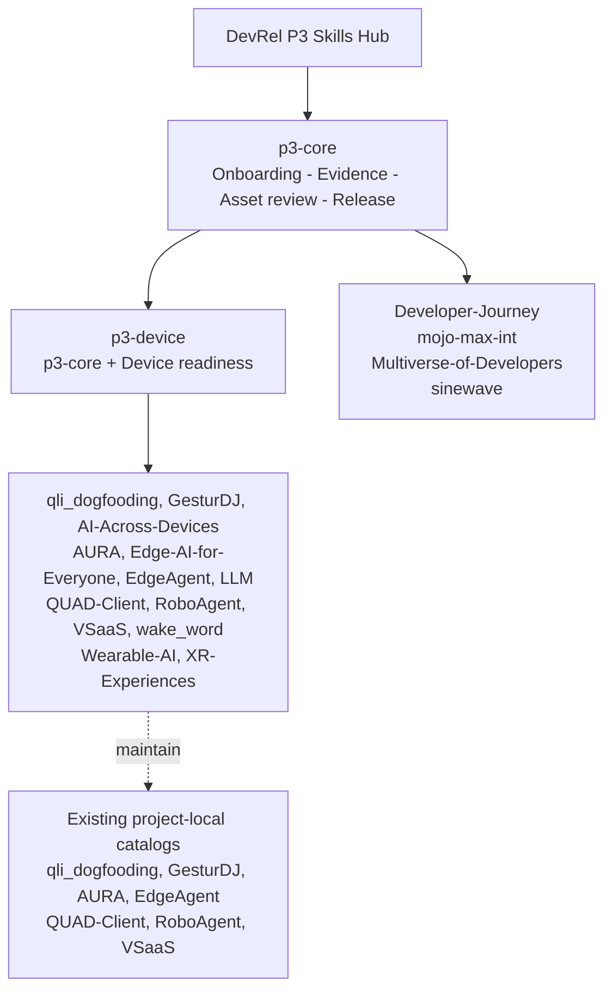

# DevRel P3 Skills

This directory is the single Skills Hub source for shared DevRel P3 skills.
It packages reusable, project-independent procedures for onboarding, evidence,
device readiness, public-asset review, and release preparation.

`skills.json` is the catalog entry point. Each skill directory is self-contained
and includes its `SKILL.md`, Synapse metadata, and any required references,
templates, or validator scripts.

Portfolio-wide routing and validation live in `portfolio/`; the Skills Hub
maintainer guide lives in `docs/`; and developer-story context lives in
`references/`. No DevRel/P3 control files are kept at the Academy root.

| Skill ID | Use when |
| --- | --- |
| `p3-project-onboarding` | Starting, reviewing, or promoting a P3 project. |
| `p3-evidence-and-compatibility` | Recording reproducible evidence and supported environments. |
| `p3-release-bundle-preparation` | Preparing an incubating, preview, stable, or LTS P3 release. |
| `p3-public-asset-license-review` | Reviewing assets before public distribution. |
| `p3-device-readiness` | Establishing a public hardware target’s documented readiness. |

## Applying the Hub Across Academy

Use shared P3 skills as project-level dependencies; do not copy their
procedures into individual project `skills/` folders. Create a project-local
skill only when the project can provide a bounded, evidence-backed procedure.
The portfolio source of truth, including proposed project-local skills, is
[`portfolio/SYNAPSE_SKILLS.md`](portfolio/SYNAPSE_SKILLS.md).

### Shared profiles

| Profile | Includes | Apply to |
| --- | --- | --- |
| `p3-core` | `p3-project-onboarding`, `p3-evidence-and-compatibility`, `p3-public-asset-license-review`, `p3-release-bundle-preparation` | Every DevRel project. |
| `p3-device` | Every `p3-core` skill plus `p3-device-readiness` | Projects that claim a board, device, sensor, camera, microphone, accelerator, or device deployment path. |

### Routing diagram

The current portfolio routing is:

- `p3-device`: `qli_dogfooding`, `GesturDJ`, `AI-Across-Devices`, `AURA`,
  `Edge-AI-for-Everyone`, `EdgeAgent`, `LLM`, `QUAD-Client`, `RoboAgent`,
  `VSaaS`, `wake_word`, `Wearable-AI`, and `XR-Experiences`.
- `p3-core`: `Developer-Journey`, `mojo-max-int`,
  `Multiverse-of-Developers`, and `sinewave`.

Project-local skill catalogs are already enabled in `qli_dogfooding`,
`GesturDJ`, `AURA`, `EdgeAgent`, `QUAD-Client`, `RoboAgent`, and `VSaaS`.
Maintain those catalogs rather than recreating them. For every other project,
implement only the next domain-specific skills named in the portfolio matrix
when their public workflow and validation evidence exist.

### Required workflow

1. Start with `p3-project-onboarding` to record demonstrated capabilities,
   public prerequisites, supported targets, exclusions, ownership, evidence,
   feedback path, and the smallest appropriate delivery lane.
2. Use `p3-evidence-and-compatibility` for every demo claim and promotion
   decision. Record the revision, environment, command, outcome, evidence, and
   known exclusions.
3. For device-profile projects, use `p3-device-readiness` before any
   device-affecting work. Obtain explicit approval before installs, flashing,
   model transfer, sensor access, or network changes.
4. Use `p3-public-asset-license-review` before publishing dependencies,
   models, datasets, binaries, or downloadable artifacts.
5. Use `p3-release-bundle-preparation` for public releases. Validate the
   release bundle, legal status, evidence, compatibility, checksums, and
   rollback instructions before promotion.

To register this catalog, add it as a folder source with path
`devrel-skills` in the owning repository's Skills Hub manifest.
