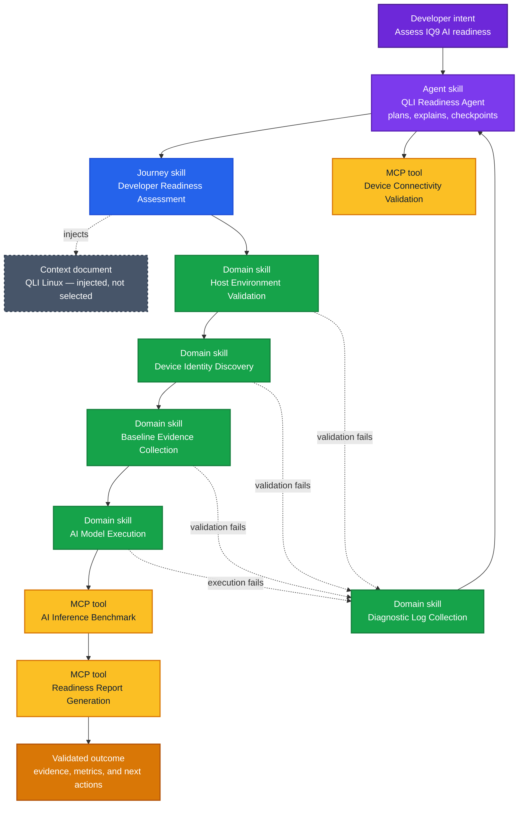
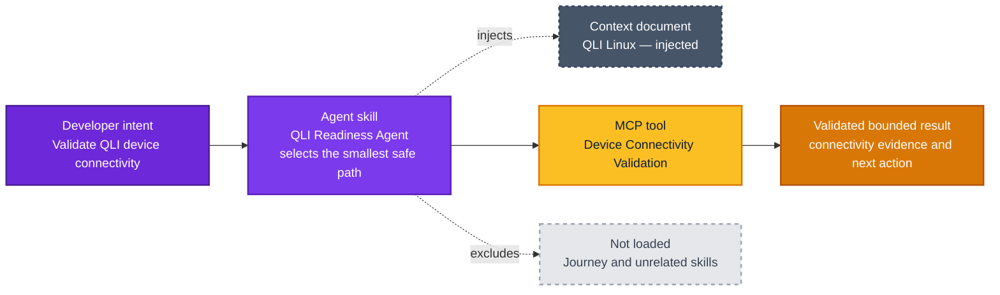

# QLI Synapse Skill Catalog

Agent frameworks should discover each `skill.yaml`, use `synapse.layer` for
selection, and load the matching skill instruction entrypoint only when needed.

| Layer | Skill IDs | Use when |
| --- | --- | --- |
| Agent | `qli-readiness-agent` | Interpret open-ended developer intent; select the skill path; enforce approval gates; checkpoint execution; route failures to recovery. |
| Context | `qli-linux-domain` | Inject as system context before any QLI skill runs. Not a selectable skill — load as a referenced document. |
| Domain | `host-environment-validation`, `device-identity-discovery`, `baseline-evidence-collection`, `ai-model-execution`, `diagnostic-log-collection` | The request is one bounded, independently verifiable operation requiring conditional judgment about which tool to invoke. |
| Journey | `developer-readiness-assessment` | The request spans multiple workflows, readiness status, reruns, comparisons, or deliverables. |
| MCP Tool | `device-connectivity-validation`, `ai-inference-benchmark`, `readiness-report-generation` | Deterministic, single-step operations. Call directly as tools; do not wrap in a skill. Check the shared MCP inventory first before implementing a new tool — if it exists, reuse it; if not, write it and contribute it back. |

## Composition Rule

Inject the QLI Linux domain context document first. For a bounded request, prefer
one domain skill. Use the journey to compose a developer outcome across multiple
operations. MCP tools are called directly by skills or the agent — they are not
selected as skills themselves.

The `qli-readiness-agent` agent skill selects, explains, checkpoints, and
adapts that composition. The hosting agent framework runs the agent skill.

## How Synapse Is Applied in QLI

This catalog turns an outcome request into a bounded, evidence-driven execution
path. For example, a developer can ask: **"Assess whether this IQ9 device is
ready to run and benchmark an AI model."** The hosting agent injects the QLI
Linux domain context, selects the journey, runs the required domain skills and
MCP tools, and returns verified evidence or an explicit recovery action.

### Routing Rules

1. [`qli-readiness-agent`](qli-readiness-agent/SKILL.md) is the agent-layer
   coordinator. It interprets open-ended developer intent, selects the smallest
   safe path, presents an approved plan, enforces approval gates, and checkpoints
   execution. Use it when the developer's request is open-ended or spans multiple
   operations. A hosting framework may bypass it for direct deterministic calls.
2. [`developer-readiness-assessment`](developer-readiness-assessment/SKILL.md)
   is selected when the request spans multiple readiness activities, reruns, or
   reporting; it composes the applicable domain skills and MCP tools.
3. [`qli-linux-domain`](qli-linux-domain/SKILL.md) is injected as context
   before any QLI skill runs — it applies QLI support boundaries, evidence
   rules, ownership, and safety gates. It is a context document, not a
   selectable skill.
4. Domain skills run only when the requested outcome needs them:
   [`host-environment-validation`](host-environment-validation/SKILL.md),
   [`device-identity-discovery`](device-identity-discovery/SKILL.md),
   [`baseline-evidence-collection`](baseline-evidence-collection/SKILL.md),
   [`ai-model-execution`](ai-model-execution/SKILL.md), and
   [`diagnostic-log-collection`](diagnostic-log-collection/SKILL.md).
5. MCP tools are called directly — no skill wrapper needed:
   [`device-connectivity-validation`](device-connectivity-validation/SKILL.md),
   [`ai-inference-benchmark`](ai-inference-benchmark/SKILL.md), and
   [`readiness-report-generation`](readiness-report-generation/SKILL.md).
   **MCP-first:** check the shared MCP inventory before implementing any new
   tool; if it exists, reuse it; if not, write it and contribute it back.
6. A failed validation routes to diagnostics and then back to the agent skill
   for a recovery decision; it does not become an unverified success.

### Bounded Task Route

The journey is not loaded for every request. When a developer asks for one
independently verifiable operation, the hosting agent injects the QLI Linux
domain context and loads only the matching domain skill (or calls the MCP
tool directly).

For example: **"Validate connectivity to this QLI device."**

| Developer request | Loaded | Not loaded |
| --- | --- | --- |
| Validate host prerequisites | QLI Linux context + [`host-environment-validation`](host-environment-validation/SKILL.md) (domain skill) | Journey and all other skills |
| Inspect the target device identity | QLI Linux context + [`device-identity-discovery`](device-identity-discovery/SKILL.md) (domain skill) | Journey and all other skills |
| Validate device connectivity | QLI Linux context + `device-connectivity-validation` (MCP tool, called directly) | Journey and all other skills |
| Benchmark an already executable AI model | QLI Linux context + `ai-inference-benchmark` (MCP tool, called directly) | Journey and unrelated skills |

Use the journey only when the requested result requires coordinating multiple
operations, preserving cross-step state, handling a recovery path across
operations, or generating readiness deliverables.

### What the Developer Receives

The result is not a copied command list. The developer receives the validated
state of each selected operation, collected evidence and benchmark metrics when
applicable, diagnostic output for failures, and the next safe action.

## Governance

Every published skill follows the five-part Synapse publishing contract:

| Contract area | `skill.yaml` fields |
| --- | --- |
| Ownership | `synapse.owner` (a named individual), `backup_owner`, `supported_versions`, `maturity` (lifecycle status) |
| Classification | `synapse.domain`, `visibility` (internal / entitled / public), `dependencies`, `developer_journey_stage` |
| Contract | `contract.inputs`, `outputs`, `validation`, `failure_behavior` |
| Authority | `synapse.authoritative_docs`, `authority.approved_tools`, `authority.endpoints`, `authority.provenance` |
| Control | `safety.requires_explicit_approval`, `control.consequential_actions`, `control.recovery_and_rollback` |

Each manifest also records its status against the six review gates in
`review_gates`: pilot means Gates 1 and 3 are met, and supported means all six are met.
Every published skill must also declare review_cadence, feedback
channel, deprecation path, and safety behavior. Domain skills and MCP tool
candidates must additionally declare a full operation contract including
negative_scope, state_before/after, failure_behavior, known_failure_modes, and
two_config_evidence. MCP tool candidates must declare a `classification_note`
explaining why they collapsed. The agent skill must declare its
responsibilities, not_responsible_for, approval_gates, and failure_behavior.
The toolkit inspector checks the catalog structure and these fields.
